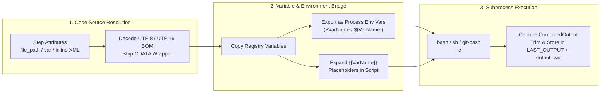

# Bash & POSIX Shell Scripting (`<script language="bash">`, `"git-bash"`, `"sh"`)

## 1. Overview

Flow supports executing **GNU Bash**, **Git Bash on Windows**, **POSIX `sh`**, and other Unix shells (`zsh`, `ksh`, `dash`, `fish`, `csh`, `tcsh`) inside declarative XML pipelines. Shell steps allow data engineers and DevOps teams to integrate classic Unix text-processing pipelines (`grep`, `awk`, `sed`, `jq`, `sort`, `uniq`), archive utilities (`tar`, `gzip`, `zstd`), file checksums (`sha256sum`), and system administration commands directly with Flow's variable registry and control flow nodes.

| `language` Attribute | Command Invoked by Flow | Supported Platforms | Notes |
| :--- | :--- | :--- | :--- |
| **`language="bash"`** | `bash -c <script>` | **Linux, macOS, FreeBSD, Windows** *(with Git Bash / MSYS2 / WSL)* | Standard GNU Bash execution with arrays, `[[ ... ]]` conditionals, and `set -euo pipefail`. |
| **`language="git-bash"`**<br/>*(alias: `"gitbash"`)* | Resolves `git-bash`, `bash`, or `C:\Program Files\Git\bin\bash.exe -c <script>` | **Windows, Linux, macOS, FreeBSD** | **Recommended when targeting Git Bash on Windows.** Automatically locates Git for Windows (`C:\Program Files\Git\bin\bash.exe`) even if it is not yet in `PATH`. |
| **`language="sh"`** | `sh -c <script>` | **Linux, macOS, FreeBSD, Alpine, Windows** *(Git Bash)* | Lightweight POSIX-compliant shell ideal for minimal container images (`alpine` / `busybox`). |
| **`language="shell"`** | `$SHELL -c <script>` *(or OS default: `sh` on Linux/FreeBSD, `zsh` on macOS, `cmd /C` on Windows)* | **All Platforms** | Automatically adapts to the host's configured `$SHELL` environment variable or OS default shell. |
| **`language="zsh"`** | `zsh -c <script>` | **macOS, Linux, FreeBSD** | Default login shell on macOS; supports extended globbing and associative arrays. |

---

## 2. Execution Architecture & Lifecycle



1. **Source Resolution**: Flow resolves the shell script source in the following order:
   - If `file_path` (or `file` / `path`) is set, Flow expands any `{{VarName}}` placeholders in the path, reads the external `.sh` file from disk, and automatically decodes UTF-8, UTF-16LE, or UTF-16BE encodings.
   - If `var` (or `variable`) is set, Flow retrieves the shell script text from that pipeline variable.
   - Otherwise, Flow uses the inline `<script>` body and strips any outer `<![CDATA[ ... ]]>` wrapper.
2. **Dual Variable Bridge**:
   - Flow snapshots all variables in the active `Registry` (`e.registry.CopyVariables()`) and injects them as environment variables (`NAME=VALUE`) into the child shell process (`$VarName` / `"${VarName}"`).
   - Flow also expands any `{{VarName}}` placeholders in the script text before execution.
3. **Executable Resolution & Context Binding**: Flow spawns the requested shell with `-c <codeToEval>` bound to the step's `context.Context` (`timeout` and pipeline cancellation). For `language="git-bash"`, Flow checks `LookPath("git-bash")`, `LookPath("bash")`, and `C:\Program Files\Git\bin\bash.exe`.
4. **Output Capture**: Combined standard output and standard error (`echo`, `printf`) are captured, trimmed of trailing newlines, and stored in `LAST_OUTPUT` and `output_var`.

---

## 3. Prerequisites on Windows (Git Bash)

On Linux, macOS, and FreeBSD, `bash` and/or `sh` are available out of the box. On **Windows**, install **Git for Windows (Git Bash)** so `flow.exe` has access to `bash.exe`, `sh.exe`, and standard Unix utilities (`grep`, `awk`, `sed`, `sha256sum`, `curl`):

```powershell
# Install Git for Windows (includes Git Bash & POSIX tools)
winget install --id Git.Git -e --source winget

# Optional: Add Git\bin and Git\usr\bin to current PowerShell session PATH
$env:PATH += ";C:\Program Files\Git\bin;C:\Program Files\Git\usr\bin"
```

> [!TIP]
> You can use `language="git-bash"` on Windows even before modifying your system `PATH`—Flow automatically checks `C:\Program Files\Git\bin\bash.exe` as a fallback. For complete Windows `PATH` persistence and line-ending (`core.autocrlf`) setup, see [Section 10.3 of the Compilation & Build Guide](guides/COMPILATION_AND_BUILD_GUIDE.md#103-installing-git-bash-on-windows-for-git-cli-script-languagebash-sh).

---

## 4. XML Attribute Reference

| Attribute | Required | Default | Description |
| :--- | :---: | :---: | :--- |
| `language` / `type` | **Yes** | — | Set to `"bash"`, `"git-bash"` (`"gitbash"`), `"sh"`, `"shell"`, or `"zsh"`. |
| `id` | No | — | Unique step identifier for logging, auditing, and telemetry. |
| `file_path` | No | — | Path to an external `.sh` file on disk. Supports `{{VarName}}` interpolation and UTF-8/UTF-16 BOM decoding. Aliases: `file`, `path`. |
| `var` | No | — | Name of a pipeline variable containing the shell script to execute. Alias: `variable`. |
| `output_var` | No | — | Pipeline variable name to store the captured `echo` / `printf` output. Aliases: `output`, `output_variable`, `out_var`. Always also populates `LAST_OUTPUT`. |
| `timeout` | No | No limit | Maximum execution duration (e.g., `"30s"`, `"5m"`). Terminates the shell process on expiration. |
| `retry_count` | No | `0` | Number of automatic retries if the script exits with a non-zero status code. |
| `retry_delay` | No | `1s` | Delay between retry attempts (e.g., `"2s"`, `"5s"`). |
| `ignore_error` | No | `false` | When `true`, logs non-zero exit codes as warnings and continues pipeline execution. |

---

## 5. Best Practices for Bash in Flow Pipelines

1. **Enable Strict Mode (`set -euo pipefail`)**:
   Start every multi-line Bash script with `set -euo pipefail`:
   - `-e`: Exit immediately if any command exits with a non-zero status.
   - `-u`: Treat unset variables as an error.
   - `-o pipefail`: Return the exit code of the first failed command in a pipeline (`cmd1 | cmd2 | cmd3`) rather than masking failures behind the last command.
2. **Double-Quote Environment Variables (`"${VarName}"`)**:
   Because Flow exports all pipeline variables into the child process environment, reference them as `"${VarName}"` instead of unquoted `{{VarName}}` to prevent word splitting or glob expansion on spaces and special characters.
3. **Use `printf` Instead of `echo` for Exact Output**:
   When populating `output_var` with a precise value or JSON payload, use `printf '%s' "${result}"` to avoid inconsistent flag handling (`echo -n` / `echo -e`) across shells.
4. **Normalize `CRLF` Line Endings When Needed**:
   If an external `.sh` file was saved on Windows with `CRLF` (`\r\n`) line endings, Bash may report `$'\r': command not found`. Configure Git with `git config --global core.autocrlf input` or save `.sh` files with `LF` line endings.

---

## 6. Practical Examples

### Example 1: Fail-Fast Log Filtering & Aggregation with `awk` (`language="bash"`)

Processes a multi-line log payload stored in a pipeline variable using `awk`, computes error and warning counts, and emits a JSON object into `LogStatsJson` for `<json_path>` extraction.

```xml
<pipeline xmlns:xsi="http://www.w3.org/2001/XMLSchema-instance"
          xsi:noNamespaceSchemaLocation="https://raw.githubusercontent.com/etl-madness/flow/main/xsd/pipeline.xsd">
    <variables>
        <variable name="RawLogLines" type="string" value="2026-11-01 INFO Job started&#10;2026-11-01 WARN Slow query (1200ms)&#10;2026-11-01 ERROR Deadlock detected&#10;2026-11-01 ERROR Connection reset&#10;2026-11-01 INFO Retry succeeded" />
        <variable name="LogStatsJson" type="string" value="" />
        <variable name="ErrorCount" type="int" value="0" />
    </variables>

    <flow>
        <script id="AnalyzeLogSeverities"
                language="bash"
                timeout="10s"
                output_var="LogStatsJson">
            <![CDATA[
            set -euo pipefail

            printf '%s\n' "${RawLogLines}" | awk '
                /INFO/  { info++ }
                /WARN/  { warn++ }
                /ERROR/ { err++ }
                END {
                    printf "{\"info\":%d,\"warn\":%d,\"error\":%d}", info+0, warn+0, err+0
                }
            '
            ]]>
        </script>

        <json_path id="ExtractErrorCount"
                   input_var="LogStatsJson"
                   query="$.error"
                   output_var="ErrorCount" />

        <assert id="VerifyErrorCount"
                var="ErrorCount"
                equals="2"
                message="Expected exactly 2 ERROR log entries" />
    </flow>
</pipeline>
```

---

### Example 2: Cross-Platform File Archiving & SHA-256 Checksum (`language="git-bash"`)

Uses `language="git-bash"` (which works on Windows via Git for Windows as well as Linux/macOS) to create a compressed `.tar.gz` archive of exported CSV files and capture its SHA-256 digest.

```xml
<pipeline xmlns:xsi="http://www.w3.org/2001/XMLSchema-instance"
          xsi:noNamespaceSchemaLocation="https://raw.githubusercontent.com/etl-madness/flow/main/xsd/pipeline.xsd">
    <variables>
        <variable name="SourceDir" type="string" value="./docs/examples" />
        <variable name="ArchiveFile" type="string" value="./temp_examples_backup.tar.gz" />
        <variable name="ArchiveSHA256" type="string" value="" />
    </variables>

    <flow>
        <script id="CreateTarGzAndHash"
                language="git-bash"
                timeout="30s"
                output_var="ArchiveSHA256">
            <![CDATA[
            set -euo pipefail

            # Create compressed tarball from SourceDir
            tar -czf "${ArchiveFile}" "${SourceDir}"

            # Compute SHA-256 checksum (extract only the 64-char hex hash)
            hash=$(sha256sum "${ArchiveFile}" | awk '{print $1}')

            # Clean up temporary archive after hashing
            rm -f "${ArchiveFile}"

            printf '%s' "${hash}"
            ]]>
        </script>

        <assert id="VerifyHashGenerated"
                condition="{{ArchiveSHA256}} != ''"
                message="Expected non-empty SHA-256 checksum" />
    </flow>
</pipeline>
```

---

### Example 3: Lightweight POSIX `sh` Readiness Probe (`language="sh"`)

Ideal for minimal Linux container environments (`alpine` / `busybox`) where `/bin/sh` is present without GNU Bash.

```xml
<pipeline xmlns:xsi="http://www.w3.org/2001/XMLSchema-instance"
          xsi:noNamespaceSchemaLocation="https://raw.githubusercontent.com/etl-madness/flow/main/xsd/pipeline.xsd">
    <variables>
        <variable name="RequiredConfig" type="string" value="mkdocs.yml" />
        <variable name="ProbeResult" type="string" value="" />
    </variables>

    <preflight>
        <script id="VerifyConfigExistsPOSIX"
                language="sh"
                timeout="5s"
                output_var="ProbeResult">
            <![CDATA[
            set -eu

            if [ ! -f "${RequiredConfig}" ]; then
                echo "Missing required file: ${RequiredConfig}" >&2
                exit 1
            fi

            line_count=$(wc -l < "${RequiredConfig}" | tr -d ' ')
            printf 'READY:%s_lines' "${line_count}"
            ]]>
        </script>
    </preflight>

    <flow>
        <script id="EchoProbeStatus" language="sh">
            <![CDATA[
            printf 'Preflight check passed (%s)\n' "${ProbeResult}"
            ]]>
        </script>
    </flow>
</pipeline>
```

---

### Example 4: Executing External `.sh` Script Files (`file_path`)

Store complex shell workflows in external `.sh` files and invoke them via `file_path` (supporting `{{VarName}}` path interpolation and automatic UTF-8 / UTF-16 BOM decoding):

```xml
<pipeline xmlns:xsi="http://www.w3.org/2001/XMLSchema-instance"
          xsi:noNamespaceSchemaLocation="https://raw.githubusercontent.com/etl-madness/flow/main/xsd/pipeline.xsd">
    <variables>
        <variable name="SCRIPTS_DIR" type="string" value="./scripts/bash" />
        <variable name="BatchDate" type="string" value="2026-11-01" />
        <variable name="CleanupSummary" type="string" value="" />
    </variables>

    <flow>
        <script id="RunStagingCleanup"
                language="bash"
                file_path="{{SCRIPTS_DIR}}/cleanup_staging.sh"
                timeout="30s"
                output_var="CleanupSummary" />
    </flow>
</pipeline>
```

Example `./scripts/bash/cleanup_staging.sh`:
```bash
#!/usr/bin/env bash
set -euo pipefail

if [[ -z "${BatchDate:-}" ]]; then
    echo "ERROR: BatchDate environment variable is required" >&2
    exit 1
fi

printf 'Cleaned staging partitions for batch %s' "${BatchDate}"
```

---

## 7. Related Documentation

- **[Multi-Language Script Guide (`script.md`)](script.md)**: Complete reference for all `<script>` runtimes (`go`, `lua`, `csx`, `pwsh`, `powershell`, `bash`, `git-bash`, `sh`, `cmd`, `sql`).
- **[PowerShell Scripting Guide (`powershell.md`)](powershell.md)**: Reference for `<script language="pwsh" | "powershell">`.
- **[Embedded Go Scripting Guide (`golang.md`)](golang.md)**: Zero-dependency in-process Go interpreter (`Yaegi`).
- **[Embedded Lua Scripting Guide (`lua.md`)](lua.md)**: Zero-dependency in-process Lua 5.1 VM (`Gopher-Lua`).
- **[C# Scripting Guide (`csx.md`)](csx.md)**: Cross-platform Roslyn C# scripting (`dotnet-script`).
- **[Compilation & Build Guide — Installing Git Bash on Windows](guides/COMPILATION_AND_BUILD_GUIDE.md#103-installing-git-bash-on-windows-for-git-cli-script-languagebash-sh)**: Step-by-step instructions for installing Git Bash and configuring `PATH` on Windows.
