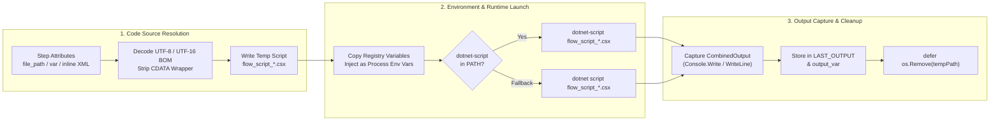

# C# Scripting (`<script language="csx">` / `dotnet-script`)

## 1. Overview

Flow supports executing **C# Script (`.csx`)** steps across **Windows, Linux, macOS, and FreeBSD** using the Roslyn-powered [`dotnet-script`](https://github.com/dotnet-script/dotnet-script) runtime (`language="csx"` or `language="dotnet-script"`).

C# scripting allows .NET engineering teams to write concise, top-level C# 12/13/14 code inside declarative Flow XML pipelines without creating `.csproj` files or pre-compiling assemblies:
- **Zero-Boilerplate Top-Level C#**: Write C# statements, `async`/`await` tasks, LINQ queries, and helper methods directly without `namespace` or `static void Main` ceremony.
- **Full .NET 10 Base Class Library (BCL)**: Immediate access to `System.Text.Json`, `System.Net.Http`, `System.IO`, `System.Linq`, `System.Security.Cryptography`, and `System.Threading.Tasks`.
- **Inline NuGet Package References (`#r "nuget: ..."`)**: Pull any NuGet package dynamically at runtime (e.g., `#r "nuget: CsvHelper, 33.0.1"`, `#r "nuget: Microsoft.Data.SqlClient, 5.2.2"`) and cache it locally in the standard NuGet cache.
- **Automatic Pipeline Variable Injection**: Flow automatically exports all current pipeline variables from its `Registry` into the `dotnet-script` process environment (`Environment.GetEnvironmentVariable("VarName")`), in addition to supporting `{{VarName}}` template interpolation.
- **Flexible Code Sourcing**: Run inline `<![CDATA[ ... ]]>` C# blocks, external `.csx` files (`file_path` / `file` / `path` with UTF-8 and UTF-16 BOM auto-decoding), or C# code stored in a pipeline variable (`var` / `variable`).
- **Context-Aware Timeouts**: The child `dotnet-script` process is bound to the step's `context.Context` (`exec.CommandContext`), terminating the process immediately if `timeout` expires or the pipeline is cancelled.

---

## 2. Execution Architecture & Lifecycle



1. **Source Resolution**: Flow resolves the C# script source in the following order:
   - If `file_path` (`file` or `path`) is set, Flow expands any `{{VarName}}` placeholders in the path, reads the external `.csx` file from disk, and decodes UTF-8, UTF-16LE, or UTF-16BE encodings.
   - If `var` (`variable`) is set, Flow loads the C# source code from that pipeline variable.
   - Otherwise, Flow reads the inline `<script>` body and strips any outer `<![CDATA[ ... ]]>` wrapper.
2. **Temporary `.csx` Materialization**: Flow writes the resolved C# code to a temporary file (`flow_script_*.csx`) in the OS temp directory and schedules automatic removal (`defer os.Remove(tempPath)`).
3. **Environment Variable Bridge**: Flow snapshots all variables in the active `Registry` (`e.registry.CopyVariables()`) and appends each `NAME=VALUE` pair to the child process environment (`cmd.Env`).
4. **Executable Resolution**: Flow checks `exec.LookPath("dotnet-script")`. If found, it executes `dotnet-script <tempPath>`; otherwise, it falls back to `dotnet script <tempPath>`.
5. **Output Capture**: Combined standard output and error (`Console.Write` / `Console.WriteLine`) are captured. On exit code `0`, trailing whitespace is trimmed and the result is stored in `LAST_OUTPUT` and `output_var`.

---

## 3. Prerequisites & Installation (`dotnet-script`)

To execute `<script language="csx">` steps, install the **.NET 10.0+ SDK** and the **`dotnet-script`** global tool on the host running `flow`:

### Step 1: Install the .NET 10 SDK

```powershell
# Windows (via winget)
winget install Microsoft.DotNet.SDK.10
```

```bash
# Ubuntu / Debian Linux
sudo apt-get update && sudo apt-get install -y dotnet-sdk-10.0

# RHEL / Rocky / AlmaLinux / Fedora
sudo dnf install -y dotnet-sdk-10.0

# macOS (via Homebrew)
brew install --cask dotnet-sdk

# FreeBSD (via pkg)
sudo pkg install -y dotnet
```

### Step 2: Install `dotnet-script` Globally & Verify `PATH`

```bash
# Install the latest dotnet-script global tool
dotnet tool install -g dotnet-script

# Ensure ~/.dotnet/tools is on PATH (Linux / macOS / FreeBSD)
export PATH="$PATH:$HOME/.dotnet/tools"

# Verify installation
dotnet-script --version
dotnet-script eval 'Console.WriteLine($"dotnet-script ready on {Environment.OSVersion}");'
```

> [!NOTE]
> For offline/pinned CI installations and full platform setup details, see [Section 10.1 of the Compilation & Build Guide](guides/COMPILATION_AND_BUILD_GUIDE.md#101-installing-dotnet-script-via-command-line-for-script-languagecsx).

---

## 4. XML Attribute Reference

| Attribute | Required | Default | Description |
| :--- | :---: | :---: | :--- |
| `language` / `type` | **Yes** | — | Set to `"csx"` or `"dotnet-script"` (case-insensitive). |
| `id` | No | — | Unique step identifier for logging, auditing, and telemetry. |
| `file_path` | No | — | Path to an external `.csx` file on disk. Supports `{{VarName}}` interpolation and UTF-8/UTF-16 BOM decoding. Aliases: `file`, `path`. |
| `var` | No | — | Name of a pipeline variable containing the C# script code to execute. Alias: `variable`. |
| `output_var` | No | — | Pipeline variable name to store the captured `Console.Write` / `Console.WriteLine` output. Aliases: `output`, `output_variable`, `out_var`. Always also populates `LAST_OUTPUT`. |
| `timeout` | No | No limit | Maximum execution time (e.g., `"30s"`, `"2m"`). Terminates the `dotnet-script` process on expiration. |
| `retry_count` | No | `0` | Number of automatic retries if the script exits with a non-zero status code or throws an unhandled exception. |
| `retry_delay` | No | `1s` | Delay between retry attempts (e.g., `"3s"`). |
| `ignore_error` | No | `false` | When `true`, logs non-zero exit codes or exceptions as warnings and continues pipeline execution. |

---

## 5. Variable Passing & Output Capture Mechanics

### 5.1 Reading Pipeline Variables via `Environment.GetEnvironmentVariable`

Because Flow injects every pipeline variable from its `Registry` into the `dotnet-script` process environment (`cmd.Env`), the safest way to read pipeline variables in C# (avoiding quote or escaping issues) is `Environment.GetEnvironmentVariable("VarName")`:

```csharp
using System;
using System.Globalization;

// Read string variable (with fallback default)
string environment = Environment.GetEnvironmentVariable("Environment") ?? "DEV";

// Parse numeric and boolean pipeline variables safely
int batchSize = int.TryParse(Environment.GetEnvironmentVariable("BatchSize"), out var b) ? b : 500;
double threshold = double.TryParse(
    Environment.GetEnvironmentVariable("Threshold"),
    NumberStyles.Any,
    CultureInfo.InvariantCulture,
    out var d) ? d : 0.95;
bool dryRun = bool.TryParse(Environment.GetEnvironmentVariable("DryRun"), out var flag) && flag;

Console.WriteLine($"Env={environment} | BatchSize={batchSize} | Threshold={threshold:F2} | DryRun={dryRun}");
```

### 5.2 Returning Values to the Pipeline (`Console.Write` / `output_var`)

Everything written to standard output (`Console.Write` or `Console.WriteLine`) is captured, trimmed of trailing newlines (`\r\n` / `\n`), and stored in `LAST_OUTPUT` and `output_var`:
- **Single Scalar Return**: Call `Console.Write(result)` at the end of the script so `output_var` receives the exact scalar value.
- **Multiple Values (Structured JSON)**: Serialize an anonymous object or `record` with `System.Text.Json.JsonSerializer.Serialize(...)` and extract individual properties downstream using `<json_path>`.
- **Signaling Failure**: Throw any unhandled exception (`throw new InvalidOperationException("...")`) or call `Environment.Exit(1)` to trigger Flow's error/retry handler.

---

## 6. Advanced `dotnet-script` Directives (`#r` & `#load`)

### 6.1 Inline NuGet Package References (`#r "nuget: ..."`)

Place `#r "nuget: <PackageId>, <Version>"` at the very top of your `.csx` script to reference NuGet packages without a project file:

```csharp
#r "nuget: CsvHelper, 33.0.1"
#r "nuget: Polly, 8.4.2"

using System.Globalization;
using System.IO;
using CsvHelper;
```

### 6.2 Referencing Shared `.csx` Scripts (`#load "..."`)

Break shared C# models, retry policies, or validation helpers into reusable `.csx` files and import them with `#load`:

```csharp
#load "./scripts/csx/shared_models.csx"
#load "./scripts/csx/validation_rules.csx"
```

> [!TIP]
> When using `#load` with relative paths inside an inline `<script language="csx">` block, remember that Flow materializes inline scripts into the OS temp directory (`flow_script_*.csx`). Either use an absolute path via an environment variable (`file_path="{{SCRIPTS_DIR}}/main.csx"`) or execute the external script file via `file_path`.

---

## 7. Practical Examples

### Example 1: Inline C# LINQ & `System.Text.Json` Transformation

Reads a JSON array of orders from a pipeline variable (`RawOrdersJson`), filters and aggregates records using C# LINQ, and outputs a structured JSON summary into `OrderMetricsJson`.

```xml
<pipeline xmlns:xsi="http://www.w3.org/2001/XMLSchema-instance"
          xsi:noNamespaceSchemaLocation="https://raw.githubusercontent.com/etl-madness/flow/main/xsd/pipeline.xsd">
    <variables>
        <variable name="MinOrderAmount" type="float" value="100.00" />
        <variable name="RawOrdersJson" type="string" value='[{"id":1,"status":"PAID","total":250.50},{"id":2,"status":"PAID","total":45.00},{"id":3,"status":"PAID","total":180.25}]' />
        <variable name="OrderMetricsJson" type="string" value="" />
        <variable name="QualifyingCount" type="int" value="0" />
    </variables>

    <flow>
        <script id="AggregateQualifyingOrders"
                language="csx"
                timeout="30s"
                output_var="OrderMetricsJson">
            <![CDATA[
            using System;
            using System.Collections.Generic;
            using System.Globalization;
            using System.Linq;
            using System.Text.Json;

            public record OrderItem(int id, string status, decimal total);

            string rawJson = Environment.GetEnvironmentVariable("RawOrdersJson") ?? "[]";
            decimal minAmount = decimal.Parse(
                Environment.GetEnvironmentVariable("MinOrderAmount") ?? "0",
                CultureInfo.InvariantCulture);

            var orders = JsonSerializer.Deserialize<List<OrderItem>>(rawJson) ?? new();
            var qualifying = orders
                .Where(o => o.status == "PAID" && o.total >= minAmount)
                .ToList();

            var summary = new
            {
                qualifying_count = qualifying.Count,
                total_revenue = qualifying.Sum(o => o.total),
                order_ids = qualifying.Select(o => o.id).ToArray()
            };

            Console.Write(JsonSerializer.Serialize(summary));
            ]]>
        </script>

        <json_path id="ExtractQualifyingCount"
                   input_var="OrderMetricsJson"
                   query="$.qualifying_count"
                   output_var="QualifyingCount" />

        <assert id="VerifyQualifyingCount"
                var="QualifyingCount"
                equals="2"
                message="Expected 2 qualifying orders >= 100.00" />
    </flow>
</pipeline>
```

---

### Example 2: Asynchronous REST API & File Processing with `async` / `await`

Top-level `async`/`await` works natively in `dotnet-script`, making it easy to combine `HttpClient`, `File.ReadAllTextAsync`, and cryptographic hashing.

```xml
<pipeline xmlns:xsi="http://www.w3.org/2001/XMLSchema-instance"
          xsi:noNamespaceSchemaLocation="https://raw.githubusercontent.com/etl-madness/flow/main/xsd/pipeline.xsd">
    <variables>
        <variable name="TargetFilePath" type="string" value="./exports/manifest.json" />
        <variable name="ManifestHash" type="string" value="" />
    </variables>

    <flow>
        <script id="ComputeFileSHA256Async"
                language="csx"
                timeout="20s"
                output_var="ManifestHash">
            <![CDATA[
            using System;
            using System.IO;
            using System.Security.Cryptography;

            string path = Environment.GetEnvironmentVariable("TargetFilePath")
                ?? throw new ArgumentNullException("TargetFilePath is not set");

            await using var stream = File.OpenRead(path);
            byte[] hashBytes = await SHA256.HashDataAsync(stream);
            Console.Write(Convert.ToHexString(hashBytes).ToLowerInvariant());
            ]]>
        </script>
    </flow>
</pipeline>
```

---

### Example 3: Pulling NuGet Packages Inline with `#r "nuget: ..."`

Uses `#r "nuget: Humanizer.Core, 2.14.1"` inside an inline C# script to format metrics for executive notifications.

```xml
<pipeline xmlns:xsi="http://www.w3.org/2001/XMLSchema-instance"
          xsi:noNamespaceSchemaLocation="https://raw.githubusercontent.com/etl-madness/flow/main/xsd/pipeline.xsd">
    <variables>
        <variable name="BytesProcessed" type="int" value="157286400" />
        <variable name="FormattedSize" type="string" value="" />
    </variables>

    <flow>
        <script id="FormatBytesWithNuGet"
                language="csx"
                timeout="60s"
                output_var="FormattedSize">
            <![CDATA[
            #r "nuget: Humanizer.Core, 2.14.1"

            using System;
            using Humanizer;

            long bytes = long.Parse(Environment.GetEnvironmentVariable("BytesProcessed") ?? "0");
            Console.Write(bytes.Bytes().Humanize("#.##"));
            ]]>
        </script>
    </flow>
</pipeline>
```

---

### Example 4: Executing External `.csx` Script Files (`file_path`)

Store complex C# transformations in dedicated `.csx` files under source control and invoke them via `file_path`:

```xml
<pipeline xmlns:xsi="http://www.w3.org/2001/XMLSchema-instance"
          xsi:noNamespaceSchemaLocation="https://raw.githubusercontent.com/etl-madness/flow/main/xsd/pipeline.xsd">
    <variables>
        <variable name="SCRIPTS_DIR" type="string" value="./scripts/csx" />
        <variable name="CustomerId" type="string" value="CUST-9041" />
        <variable name="ReconcileOutput" type="string" value="" />
    </variables>

    <flow>
        <script id="RunCustomerReconciliation"
                language="csx"
                file_path="{{SCRIPTS_DIR}}/reconcile_customer.csx"
                timeout="45s"
                output_var="ReconcileOutput" />
    </flow>
</pipeline>
```

Example `./scripts/csx/reconcile_customer.csx`:
```csharp
using System;

string customerId = Environment.GetEnvironmentVariable("CustomerId") ?? "";
if (string.IsNullOrWhiteSpace(customerId))
{
    Console.Error.WriteLine("CustomerId cannot be empty");
    Environment.Exit(1);
}

Console.Write($"VERIFIED:{customerId}");
```

---

## 8. Comparing C# Script (`csx`), Embedded Go (`go`), and Embedded Lua (`lua`)

| Criterion | C# Script (`language="csx"`) | Embedded Go (`language="go"`) | Embedded Lua (`language="lua"`) |
| :--- | :--- | :--- | :--- |
| **Execution Model** | External process (`dotnet-script` / Roslyn) | In-process VM (**Yaegi**) | In-process VM (**Gopher-Lua**) |
| **External Prerequisites** | .NET SDK 10.0+ & `dotnet-script` global tool | **None** (Built into `flow`) | **None** (Built into `flow`) |
| **Startup Latency** | Moderate (Roslyn compilation & process spawn; cached on repeat runs) | Fast (in-memory symbol binding) | Ultra-fast (lightweight Lua 5.1 state) |
| **Variable Access** | `Environment.GetEnvironmentVariable("Key")` + `{{Key}}` | `"host/vars"` (`vars.GetString`, `vars.GetInt`, etc.) | Global `vars` table (`vars.Get`, `vars.Set`) |
| **Package Ecosystem** | Full **NuGet** (`#r "nuget: Package, Version"`) & .NET BCL | Full **Go `stdlib`** + `"host/db"` + `-gopath` | Lua 5.1 standard library (`string`, `table`, `math`, `os`) |
| **Best Use Cases** | Leveraging NuGet packages, LINQ data transformations, existing enterprise C#/.NET logic | Zero-dependency cross-platform scripts, direct `"host/db"` SQL pool access, Go cryptography | Fast business rule evaluation, building/filtering slices (`[]any`) for `<foreach>` |

---

## 9. Related Documentation

- **[Multi-Language Script Guide (`script.md`)](script.md)**: Complete reference for all `<script>` runtimes (`go`, `lua`, `csx`, `pwsh`, `powershell`, `bash`, `cmd`, `sql`).
- **[Embedded Go Scripting Guide (`golang.md`)](golang.md)**: Reference for the built-in Yaegi Go interpreter (`"host/vars"` and `"host/db"`).
- **[Embedded Lua Scripting Guide (`lua.md`)](lua.md)**: Reference for the built-in Gopher-Lua VM and global `vars` bridge.
- **[PowerShell Scripting Guide (`powershell.md`)](powershell.md)**: Reference for PowerShell 7+ (`pwsh`) and Windows PowerShell 5.1 (`powershell`).
- **[Bash & POSIX Shell Scripting Guide (`bash.md`)](bash.md)**: Reference for `bash`, `git-bash`, `sh`, and `zsh` scripts.
- **[Compilation & Build Guide — Installing `dotnet-script`](guides/COMPILATION_AND_BUILD_GUIDE.md#101-installing-dotnet-script-via-command-line-for-script-languagecsx)**: Platform-by-platform installation guide for .NET 10 SDK and `dotnet-script`.
