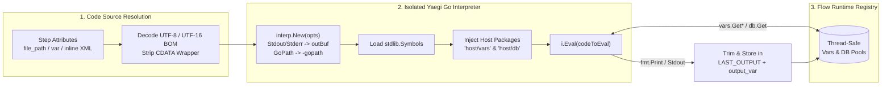

# Embedded Go Scripting (`<script language="go">`)

## 1. Overview

Flow embeds a complete, zero-dependency **Go interpreter** powered by [Yaegi (`github.com/traefik/yaegi`)](https://github.com/traefik/yaegi). Because both the Yaegi evaluation engine and the Go standard library symbols (`stdlib.Symbols`) are compiled directly into the `flow` binary, `<script language="go">` steps execute **in-process** across **Windows, Linux, macOS, and FreeBSD** without requiring the Go SDK, a C compiler, or any external runtime on target hosts.

Key capabilities of Flow's embedded Go runtime include:
- **Zero External Dependencies**: Executes identically in air-gapped environments, minimal container images (`scratch` / `distroless` / `alpine`), and developer workstations.
- **Full Go Standard Library Access**: Import standard Go packages (`fmt`, `encoding/json`, `encoding/csv`, `net/http`, `crypto/hmac`, `crypto/sha256`, `database/sql`, `regexp`, `os`, `path/filepath`, `time`, `strings`, `strconv`, `math`, etc.) directly inside pipeline steps.
- **Built-in Host Bridges (`"host/vars"` & `"host/db"`)**:
  - `"host/vars"` provides strongly-typed getters (`GetString`, `GetInt`, `GetFloat`, `GetBool`, `GetTime`, `GetDateTime`, `Get`, `GetAll`) backed directly by Flow's thread-safe `Registry`.
  - `"host/db"` provides direct access to registered `<database>` `*sql.DB` connection pools (`db.Get("alias")`) and the high-speed streaming ETL engine (`db.StreamETL(...)`).
- **Flexible Code Sourcing**: Execute inline `<![CDATA[ ... ]]>` Go programs, external `.go` files (`file_path`, `file`, or `path` with automatic UTF-8 / UTF-16 BOM decoding), or dynamic source code stored in a pipeline variable (`var` / `variable`).
- **In-Memory Output Capture**: All output written to `fmt.Print`, `fmt.Println`, `fmt.Printf`, or `os.Stdout` / `os.Stderr` is captured into an in-memory buffer and stored in `LAST_OUTPUT` and the variable specified by `output_var`.
- **Thread-Safe Parallel Execution**: Each `<script language="go">` execution initializes an isolated `*interp.Interpreter` instance bound to the current worker's `Registry`.

---

## 2. Execution Architecture & Lifecycle



1. **Source Resolution**: Flow resolves the Go source code in the following order:
   - If `file_path` (or `file` / `path`) is specified, Flow expands any `{{VarName}}` placeholders in the file path, reads the `.go` file from disk, and automatically decodes UTF-8, UTF-16LE, or UTF-16BE content.
   - If `var` (or `variable`) is specified and non-empty in the registry, Flow loads the Go source code from that pipeline variable.
   - Otherwise, Flow uses the inline `<script>` body (stripping any outer `<![CDATA[ ... ]]>` wrapper).
2. **Interpreter Initialization**: Flow creates a fresh Yaegi `*interp.Interpreter` configured with an in-memory `bytes.Buffer` for `Stdout`/`Stderr` and the configured `GOPATH` (`-gopath` CLI flag or `Executor.SetGoPath`).
3. **Symbol Registration**: Flow loads Go's standard library symbols (`stdlib.Symbols`) and registers the built-in `"host/vars"` and `"host/db"` packages.
4. **Evaluation (`i.Eval`)**: Yaegi compiles and evaluates the Go source code in-memory. If the script defines `package main` and `func main()`, Yaegi executes `main()`.
5. **Output Capture**: When evaluation succeeds, the captured `Stdout`/`Stderr` buffer is trimmed of leading/trailing whitespace and written to `LAST_OUTPUT` and `output_var`.

---

## 3. XML Attribute & CLI Flag Reference

### `<script>` XML Attributes for Go

| Attribute | Required | Default | Description |
| :--- | :---: | :---: | :--- |
| `language` / `type` | **Yes** | — | Must be set to `"go"` (case-insensitive). |
| `id` | No | — | Unique step identifier for logging, auditing, and telemetry. |
| `file_path` | No | — | Path to an external `.go` source file. Supports `{{VarName}}` interpolation and UTF-8/UTF-16 BOM decoding. Aliases: `file`, `path`. |
| `var` | No | — | Name of a pipeline variable containing the Go source code to execute. Alias: `variable`. |
| `output_var` | No | — | Pipeline variable name to store the captured `fmt.Print*` / `Stdout` output. Aliases: `output`, `output_variable`, `out_var`. Always also populates `LAST_OUTPUT`. |
| `timeout` | No | No limit | Maximum execution duration (e.g., `"10s"`, `"2m"`). |
| `retry_count` | No | `0` | Number of automatic retry attempts if evaluation returns an error or panics. |
| `retry_delay` | No | `1s` | Delay between retry attempts (e.g., `"2s"`, `"5s"`). |
| `ignore_error` | No | `false` | When `true`, logs script failures as warnings and continues pipeline execution. |

### Related CLI Flag & SDK Hooks

| CLI Flag / SDK Method | Description |
| :--- | :--- |
| `-gopath <dir>` | Sets `interp.Options.GoPath` for the embedded Yaegi interpreter so scripts can import external source packages located under `<dir>/src/...`. |
| `executor.SetGoPath(path)` | Programmatic Go SDK method to configure `GOPATH` for Yaegi. |
| `executor.SetInterpHook(fn)` | Programmatic Go SDK hook (`func(*interp.Options)`) to customize Yaegi interpreter options before evaluation. |

---

## 4. Built-in Host Bridges (`"host/vars"` & `"host/db"`)

Flow injects two native host packages into every `<script language="go">` interpreter instance: `"host/vars"` and `"host/db"`.

### 4.1 `"host/vars"` — Pipeline Variable Registry Access

Import `"host/vars"` to read typed variables or inspect the full variable map from Flow's thread-safe `Registry`:

```go
package main

import (
    "fmt"
    "host/vars"
)

func main() {
    env      := vars.GetString("Environment")
    batchID  := vars.GetInt("BatchID")
    taxRate  := vars.GetFloat("TaxRate")
    isActive := vars.GetBool("IsActive")
    cutoff   := vars.GetTime("CutoffTimestamp")
    all      := vars.GetAll()

    fmt.Printf("env=%s batch=%d rate=%.2f active=%v cutoff=%s total_vars=%d",
        env, batchID, taxRate, isActive, cutoff.Format("2006-01-02"), len(all))
}
```

#### `"host/vars"` Function Reference

| Function Signature | Return Type | Description |
| :--- | :--- | :--- |
| `vars.Get(name string)` | `interface{}` | Returns the raw underlying Go value stored in the registry for `name` (or `nil` if unset). |
| `vars.GetAll()` | `map[string]interface{}` | Returns a thread-safe shallow copy of all variables currently stored in the pipeline registry. |
| `vars.GetString(name string)` | `string` | Returns variable `name` formatted as a `string`. Returns `""` if unset. |
| `vars.GetInt(name string)` | `int` | Returns variable `name` converted to `int` (automatically parses integer strings or converts `int64`/`float64`). Returns `0` if unset or invalid. |
| `vars.GetBool(name string)` | `bool` | Returns variable `name` converted to `bool` (parses `"true"`, `"false"`, `"1"`, `"0"`). Returns `false` if unset or invalid. |
| `vars.GetFloat(name string)` | `float64` | Returns variable `name` converted to `float64` (parses numeric strings or converts `int`/`int64`/`float32`). Returns `0.0` if unset or invalid. |
| `vars.GetTime(name string)` | `time.Time` | Returns variable `name` as a `time.Time` value. Automatically parses `2006-01-02 15:04:05`, `.999`, `.999999`, `RFC3339`, `2006-01-02T15:04:05`, and `2006-01-02`. Returns `time.Time{}` (zero time) if unset or unparseable. |
| `vars.GetDateTime(name string)` | `time.Time` | Alias for `vars.GetTime(name)`. |

---

### 4.2 `"host/db"` — Direct Database Connection Pool & Stream ETL Access

Import `"host/db"` to obtain the live `*sql.DB` connection pool for any `<database>` registered in the pipeline or to trigger programmatic cross-database streaming:

| Function Signature | Return Type | Description |
| :--- | :--- | :--- |
| `db.Get(name string)` | `(*sql.DB, error)` | Returns the active `*sql.DB` connection pool for the `<database name="...">` alias registered in the pipeline. Do **not** call `conn.Close()` inside the script, as the pool is managed by the Flow `Registry`. |
| `db.StreamETL(srcDB, query, dstDB, targetTable string, opts flow.ETLOptions)` | `(int64, error)` | Streams rows in $O(1)$ memory from `srcDB` using `query` into `targetTable` on `dstDB`, returning the number of rows copied. |

```go
package main

import (
    "fmt"
    "host/db"
)

func main() {
    conn, err := db.Get("ReportingDB")
    if err != nil {
        panic(err)
    }

    var activeUsers int
    if err := conn.QueryRow("SELECT COUNT(*) FROM users WHERE active = 1").Scan(&activeUsers); err != nil {
        panic(err)
    }

    fmt.Print(activeUsers)
}
```

---

### 4.3 Returning Data to the Pipeline (`output_var` & Structured JSON)

Any text written to standard output (`fmt.Print`, `fmt.Println`, `fmt.Printf`) is captured by Flow, trimmed of surrounding whitespace, and stored in both:
1. **`LAST_OUTPUT`** (always populated automatically).
2. The pipeline variable specified by **`output_var="..."`**.

> [!TIP]
> **Returning Multiple Values from a Go Script**: When a Go script needs to return multiple computed fields back to the pipeline, serialize a struct or `map[string]any` to JSON with `json.NewEncoder(os.Stdout).Encode(...)` into `output_var`, and extract individual fields in downstream `<json_path>` steps (see [Example 3](#example-3-emitting-structured-json-for-downstream-json_path-steps)).

---

## 5. Available Go Standard Library Packages

Because `stdlib.Symbols` is pre-loaded into Yaegi, your `<script language="go">` steps can import Go standard library packages without any external dependencies:

| Category | Standard Library Packages | Common Pipeline Use Cases |
| :--- | :--- | :--- |
| **Data Formats & Serialization** | `encoding/json`, `encoding/csv`, `encoding/xml`, `encoding/base64`, `encoding/hex` | Parsing/generating complex JSON payloads, custom CSV transformations, Base64/Hex encoding. |
| **Cryptography & Hashing** | `crypto/hmac`, `crypto/sha256`, `crypto/sha512`, `crypto/aes`, `crypto/cipher`, `crypto/rand` | Computing webhook HMAC signatures, SHA-256 file checksums, token generation. |
| **Networking & HTTP** | `net/http`, `net/url`, `net`, `io` | Custom OAuth2 token handshakes, multi-part form uploads, TCP readiness probes. |
| **Database & SQL** | `database/sql` (paired with `"host/db"`) | Custom cursor logic, multi-query reconciliation, dynamic metadata inspection. |
| **Text & Regex** | `strings`, `strconv`, `regexp`, `bytes`, `unicode`, `text/tabwriter` | Complex PII scrubbing, regex tokenization, number/boolean parsing. |
| **Files, Archives & OS** | `os`, `path/filepath`, `io/fs`, `archive/zip`, `compress/gzip` | Compressing/extracting `.zip`/`.gz` archives, directory globbing, cross-platform path joining. |
| **Date, Time & Math** | `time`, `math`, `math/big`, `math/rand`, `sort` | Business-day calculations, timezone conversions, financial rounding, sorting slices. |

---

## 6. Practical Examples

### Example 1: Reading Typed Pipeline Variables & Computing HMAC-SHA256 Signatures

Uses `"host/vars"` together with Go's `crypto/hmac` and `crypto/sha256` packages to sign an API payload and store the hex digest in `WebhookSignature`.

```xml
<pipeline xmlns:xsi="http://www.w3.org/2001/XMLSchema-instance"
          xsi:noNamespaceSchemaLocation="https://raw.githubusercontent.com/etl-madness/flow/main/xsd/pipeline.xsd">
    <variables>
        <variable name="WebhookSecret" type="string" value="whsec_live_98a7bc65d4e3f210" />
        <variable name="AccountID" type="int" value="10482" />
        <variable name="EventType" type="string" value="batch.completed" />
        <variable name="WebhookSignature" type="string" value="" />
    </variables>

    <flow>
        <script id="ComputeWebhookHMAC"
                language="go"
                timeout="10s"
                output_var="WebhookSignature">
            <![CDATA[
            package main

            import (
                "crypto/hmac"
                "crypto/sha256"
                "encoding/hex"
                "fmt"
                "host/vars"
            )

            func main() {
                secret    := vars.GetString("WebhookSecret")
                accountID := vars.GetInt("AccountID")
                eventType := vars.GetString("EventType")

                payload := fmt.Sprintf("account=%d&event=%s", accountID, eventType)
                mac := hmac.New(sha256.New, []byte(secret))
                mac.Write([]byte(payload))

                fmt.Print(hex.EncodeToString(mac.Sum(nil)))
            }
            ]]>
        </script>

        <assert id="VerifySignatureGenerated"
                condition="{{WebhookSignature}} != ''"
                message="Expected non-empty HMAC-SHA256 signature" />
    </flow>
</pipeline>
```

---

### Example 2: Direct Database Querying & Reconciliation via `"host/db"`

Retrieves a registered `<database>` connection pool using `db.Get("WarehouseDB")` and executes custom SQL validation logic using Go's `database/sql` package.

```xml
<pipeline xmlns:xsi="http://www.w3.org/2001/XMLSchema-instance"
          xsi:noNamespaceSchemaLocation="https://raw.githubusercontent.com/etl-madness/flow/main/xsd/pipeline.xsd">
    <variables>
        <variable name="MinExpectedRows" type="int" value="100" />
        <variable name="ReconcileStatus" type="string" value="" />
    </variables>

    <databases>
        <database name="WarehouseDB"
                  driver="sqlite"
                  connection_string="file:warehouse.db?cache=shared&amp;mode=rwc" />
    </databases>

    <flow>
        <script id="ReconcileStagingCounts"
                language="go"
                timeout="30s"
                output_var="ReconcileStatus">
            <![CDATA[
            package main

            import (
                "fmt"
                "host/db"
                "host/vars"
            )

            func main() {
                conn, err := db.Get("WarehouseDB")
                if err != nil {
                    panic(fmt.Errorf("failed to resolve WarehouseDB: %w", err))
                }

                minRows := vars.GetInt("MinExpectedRows")

                var actualRows int
                err = conn.QueryRow("SELECT COUNT(*) FROM staging_orders WHERE status = 'READY'").Scan(&actualRows)
                if err != nil {
                    panic(fmt.Errorf("count query failed: %w", err))
                }

                if actualRows < minRows {
                    panic(fmt.Errorf("staging row count (%d) is below threshold (%d)", actualRows, minRows))
                }

                fmt.Printf("OK:%d", actualRows)
            }
            ]]>
        </script>
    </flow>
</pipeline>
```

---

### Example 3: Emitting Structured JSON for Downstream `<json_path>` Steps

When a Go script computes multiple metrics, print a JSON object to `output_var` and extract fields into individual pipeline variables with `<json_path>`.

```xml
<pipeline xmlns:xsi="http://www.w3.org/2001/XMLSchema-instance"
          xsi:noNamespaceSchemaLocation="https://raw.githubusercontent.com/etl-madness/flow/main/xsd/pipeline.xsd">
    <variables>
        <variable name="RawInput" type="string" value="  alice@example.com, bob@example.com, alice@example.com  " />
        <variable name="DedupeMetricsJSON" type="string" value="" />
        <variable name="UniqueCount" type="int" value="0" />
    </variables>

    <flow>
        <script id="DeduplicateEmails"
                language="go"
                output_var="DedupeMetricsJSON">
            <![CDATA[
            package main

            import (
                "encoding/json"
                "fmt"
                "host/vars"
                "sort"
                "strings"
            )

            type Result struct {
                UniqueCount int      `json:"unique_count"`
                Emails      []string `json:"emails"`
            }

            func main() {
                raw := strings.TrimSpace(vars.GetString("RawInput"))
                seen := make(map[string]struct{})
                var unique []string

                for _, part := range strings.Split(raw, ",") {
                    email := strings.ToLower(strings.TrimSpace(part))
                    if email == "" {
                        continue
                    }
                    if _, exists := seen[email]; !exists {
                        seen[email] = struct{}{}
                        unique = append(unique, email)
                    }
                }
                sort.Strings(unique)

                out, err := json.Marshal(Result{
                    UniqueCount: len(unique),
                    Emails:      unique,
                })
                if err != nil {
                    panic(err)
                }
                fmt.Print(string(out))
            }
            ]]>
        </script>

        <json_path id="ExtractUniqueCount"
                   input_var="DedupeMetricsJSON"
                   query="$.unique_count"
                   output_var="UniqueCount" />

        <assert id="VerifyDeduplicated"
                var="UniqueCount"
                equals="2"
                message="Expected 2 unique email addresses" />
    </flow>
</pipeline>
```

---

### Example 4: Executing External `.go` Script Files (`file_path`)

Store reusable Go scripts on disk and invoke them via `file_path` (supporting `{{VarName}}` path interpolation and automatic UTF-8 / UTF-16 BOM decoding):

```xml
<pipeline xmlns:xsi="http://www.w3.org/2001/XMLSchema-instance"
          xsi:noNamespaceSchemaLocation="https://raw.githubusercontent.com/etl-madness/flow/main/xsd/pipeline.xsd">
    <variables>
        <variable name="SCRIPTS_DIR" type="string" value="./scripts/go" />
        <variable name="ArchivePath" type="string" value="./exports/daily_dump.zip" />
        <variable name="ChecksumSHA256" type="string" value="" />
    </variables>

    <flow>
        <script id="ComputeArchiveSHA256"
                language="go"
                file_path="{{SCRIPTS_DIR}}/sha256_file.go"
                timeout="30s"
                output_var="ChecksumSHA256" />
    </flow>
</pipeline>
```

Example `./scripts/go/sha256_file.go`:
```go
package main

import (
    "crypto/sha256"
    "encoding/hex"
    "fmt"
    "host/vars"
    "io"
    "os"
)

func main() {
    path := vars.GetString("ArchivePath")
    f, err := os.Open(path)
    if err != nil {
        panic(err)
    }
    defer f.Close()

    h := sha256.New()
    if _, err := io.Copy(h, f); err != nil {
        panic(err)
    }
    fmt.Print(hex.EncodeToString(h.Sum(nil)))
}
```

---

## 7. Choosing Between Embedded Go (`go`), Embedded Lua (`lua`), and C# Script (`csx`)

| Criterion | Embedded Go (`language="go"`) | Embedded Lua (`language="lua"`) | C# Script (`language="csx"`) |
| :--- | :--- | :--- | :--- |
| **Runtime Engine** | Built-in **Yaegi** (`github.com/traefik/yaegi`) | Built-in **Gopher-Lua** (`github.com/yuin/gopher-lua`) | External **`dotnet-script`** CLI (.NET 10+ Roslyn) |
| **External Install Needed?** | **No** (Compiled into `flow`) | **No** (Compiled into `flow`) | **Yes** (`dotnet-script` & .NET SDK) |
| **Pipeline Variable Access** | `"host/vars"` (`vars.GetString`, `vars.GetInt`, `vars.GetTime`, etc.) + `{{Var}}` | Global `vars` table (`vars.Get`, `vars.Set`, `vars.GetAll`) + `{{Var}}` | Process env vars (`Environment.GetEnvironmentVariable`) + `{{Var}}` |
| **Direct `<database>` Pool Access** | **Yes** via `"host/db"` (`db.Get`, `db.StreamETL`) | Via pipeline `<sql>` steps | Via ADO.NET / `#r "nuget: Microsoft.Data.SqlClient"` |
| **Third-Party Libraries** | Go `stdlib` + `-gopath` source packages | Lua 5.1 standard libraries | Full NuGet ecosystem via `#r "nuget: Name, Ver"` |
| **Best Use Cases** | Direct DB pool queries, cryptography (`hmac`/`sha256`/`aes`), archive/file I/O, HTTP/network probes, zero-dependency cross-platform steps | Ultra-fast in-memory business rules, direct `vars.Set` table/slice mutations for `<foreach>` | Existing enterprise .NET/C# libraries, LINQ transformations, NuGet SDK integrations |

---

## 8. Related Documentation

- **[Multi-Language Script Guide (`script.md`)](script.md)**: Complete reference for all `<script>` runtimes (`go`, `lua`, `csx`, `pwsh`, `powershell`, `bash`, `cmd`, `sql`).
- **[Embedded Lua Scripting Guide (`lua.md`)](lua.md)**: Reference for the built-in Gopher-Lua VM and global `vars` bridge.
- **[C# Scripting Guide (`csx.md`)](csx.md)**: Reference for executing C# `.csx` scripts and NuGet packages with `dotnet-script`.
- **[PowerShell Scripting Guide (`powershell.md`)](powershell.md)**: Reference for PowerShell 7+ (`pwsh`) and Windows PowerShell 5.1 (`powershell`).
- **[Bash & POSIX Shell Scripting Guide (`bash.md`)](bash.md)**: Reference for `bash`, `git-bash`, `sh`, and `zsh` scripts.
- **[Compilation & Build Guide (`COMPILATION_AND_BUILD_GUIDE.md`)](guides/COMPILATION_AND_BUILD_GUIDE.md)**: Details on how Yaegi is compiled into the standalone `flow` binary.
