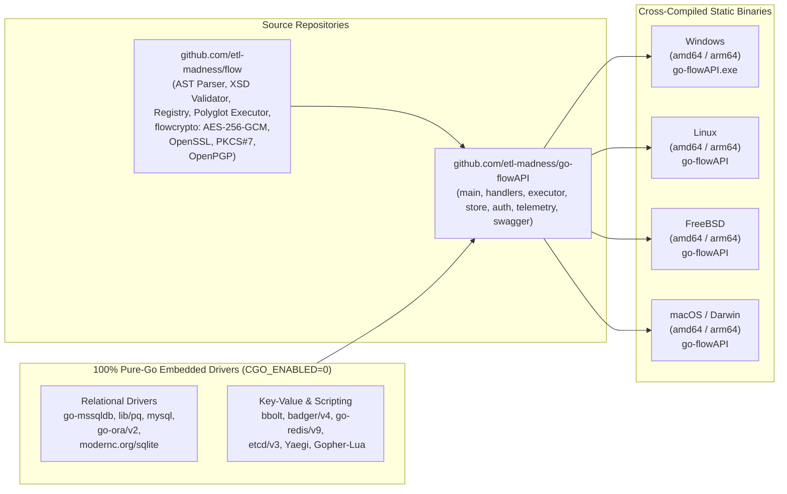
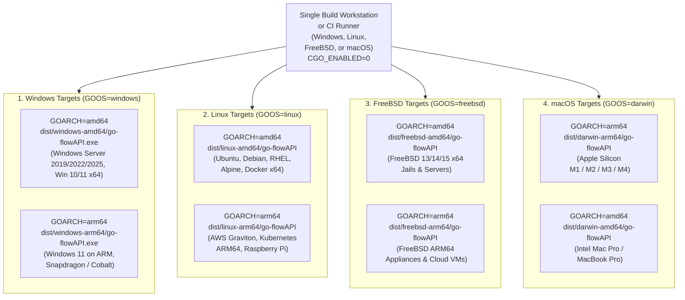

# `go-flowAPI` — Cross-Platform Compilation & Build Options Guide

> **Complete Reference for Cloning, Building, Cross-Compiling, and Packaging `go-flowAPI`**  
> **Target Binary:** `go-flowAPI` (`go-flowAPI.exe`)  
> **Supported OS Targets:** Windows, Linux, FreeBSD, macOS (`amd64` & `arm64`)  
> **Go Toolchain:** Go `1.26.5+` | **Pure-Go Static Compilation:** Supported (`CGO_ENABLED=0`)

This guide provides step-by-step instructions for compiling **`go-flowAPI`** from source across **Windows**, **Linux**, **FreeBSD**, and **macOS**, configuring compiler and linker optimizations, managing module dependencies (`github.com/etl-madness/flow`), and automating multi-platform release builds.

---

## Table of Contents

- [`go-flowAPI` — Cross-Platform Compilation \& Build Options Guide](#go-flowapi-cross-platform-compilation-build-options-guide)
  - [Table of Contents](#table-of-contents)
  - [1. Build Architecture \& Pure-Go Driver Stack](#1-build-architecture-pure-go-driver-stack)
  - [2. Prerequisites \& Repository Layout](#2-prerequisites-repository-layout)
    - [2.1 Toolchain Requirements](#21-toolchain-requirements)
    - [2.2 Cloning \& Module Setup](#22-cloning-module-setup)
  - [3. Quick Native Build (Windows, Linux, FreeBSD, macOS)](#3-quick-native-build-windows-linux-freebsd-macos)
    - [Windows (PowerShell / Command Prompt)](#windows-powershell-command-prompt)
    - [Linux, FreeBSD \& macOS (Bash / Zsh / Sh)](#linux-freebsd-macos-bash-zsh-sh)
  - [4. Complete Reference of Supported `go build` Options](#4-complete-reference-of-supported-go-build-options)
  - [5. Cross-Compilation Matrix (Windows, Linux, FreeBSD, macOS)](#5-cross-compilation-matrix-windows-linux-freebsd-macos)
    - [Target Platform Matrix](#target-platform-matrix)
    - [5.1 Cross-Compiling from Windows (PowerShell)](#51-cross-compiling-from-windows-powershell)
    - [5.2 Cross-Compiling from Linux, FreeBSD, or macOS (Bash / Zsh / Sh)](#52-cross-compiling-from-linux-freebsd-or-macos-bash-zsh-sh)
  - [6. OS-Specific Build Tags (`win_groups_windows.go` vs. `win_groups_other.go`)](#6-os-specific-build-tags-win_groups_windowsgo-vs-win_groups_othergo)
  - [7. Air-Gapped \& Offline Vendor Builds](#7-air-gapped-offline-vendor-builds)
  - [8. Automated Multi-Platform Release Scripts (PowerShell \& Bash)](#8-automated-multi-platform-release-scripts-powershell-bash)
    - [8.1 PowerShell Multi-Platform Builder (`build-release.ps1`)](#81-powershell-multi-platform-builder-build-releaseps1)
    - [8.2 POSIX Shell Multi-Platform Builder (`build-release.sh`)](#82-posix-shell-multi-platform-builder-build-releasesh)
  - [9. Running Tests \& Post-Build Verification](#9-running-tests-post-build-verification)
  - [Related Documentation](#related-documentation)

---

## 1. Build Architecture & Pure-Go Driver Stack

`go-flowAPI` embeds the core `flow` execution engine, the `flow/flowcrypto` cryptographic suite, and **100% pure-Go database drivers** for all five supported relational backends plus four Key-Value engines. Because no C bindings (`cgo`) are required, you can cross-compile static executables for any target OS from a single build machine.



---

## 2. Prerequisites & Repository Layout

### 2.1 Toolchain Requirements
1. **Go SDK**: Version `1.26.5` or newer.
2. **Git**: Version `2.30+`.
3. **C Compiler**: **Not required** for standard or production builds (`CGO_ENABLED=0`). Only required if running tests or builds with `-race` (`CGO_ENABLED=1`).

### 2.2 Cloning & Module Setup
`go-flowAPI` imports `github.com/etl-madness/flow` (including `github.com/etl-madness/flow/flowcrypto`) as a standard versioned Go module:

```bash
# Clone go-flowAPI
git clone https://github.com/etl-madness/go-flowAPI.git
cd go-flowAPI

# Download and verify Go module dependencies
go mod download
go mod verify
```

---

## 3. Quick Native Build (Windows, Linux, FreeBSD, macOS)

### Windows (PowerShell / Command Prompt)
```powershell
# Standard development build
go build -o go-flowAPI.exe .

# Production static build (stripped symbols & trimmed paths)
$env:CGO_ENABLED = "0"
go build -trimpath -ldflags="-s -w" -o go-flowAPI.exe .
```

### Linux, FreeBSD & macOS (Bash / Zsh / Sh)
```bash
# Standard development build
go build -o go-flowAPI .

# Production static build (stripped symbols & trimmed paths)
CGO_ENABLED=0 go build -trimpath -ldflags="-s -w" -o go-flowAPI .
```

---

## 4. Complete Reference of Supported `go build` Options

| Option / Environment Variable | Category | Effect on `go-flowAPI` | Recommended Use Case |
| :--- | :--- | :--- | :--- |
| **`-o <path>`** | Output | Specifies the output binary name and directory (`go-flowAPI.exe`, `dist/go-flowAPI`). | All builds |
| **`CGO_ENABLED=0`** | Portability / Static Link | Disables `cgo`, producing a **100% static binary** with zero `libc` or C library dependencies. | Production, Docker `alpine` / `scratch`, Cross-compilation |
| **`-trimpath`** | Security / Reproducibility | Removes local workstation file paths from the compiled binary and stack traces. | Production releases & container images |
| **`-ldflags="-s -w"`** | Size Optimization | Strips the symbol table (`-s`) and DWARF debug info (`-w`), reducing binary size by ~25–30%. | Production servers & containers |
| **`-buildvcs=true\|false`** | Provenance | Embeds (or omits) Git commit SHA, timestamp, and dirty status (`go version -m`). | CI/CD auditing (`true`) or reproducible builds (`false`) |
| **`-mod=readonly`** | Dependency Lock | Ensures `go.mod` and `go.sum` are not mutated during compilation. | CI/CD pipelines |
| **`-mod=vendor`** | Offline / Air-Gapped | Compiles strictly from the local `./vendor` folder with zero network calls. | Air-gapped enterprise environments |
| **`-race`** | Concurrency Verification | Enables the Go data race detector across concurrent HTTP requests and `<parallel>` runs (requires `CGO_ENABLED=1`). | QA & load testing |
| **`-gcflags="all=-N -l"`** | Interactive Debugging | Disables compiler optimizations (`-N`) and inlining (`-l`) for stepping through code in Delve (`dlv`). | Local debugging |
| **`-pgo=auto`** | Performance | Enables Profile-Guided Optimization when a `default.pgo` CPU profile is present. | High-throughput API & bulk ETL workloads |
| **`GOAMD64=v1..v4`** | x86-64 Microarchitecture | Selects x86-64 feature level (`v1` SSE2 baseline, `v3` AVX2/BMI2/FMA, `v4` AVX-512). | Modern cloud instances & bare-metal servers |
| **`GOARM64=v8.0..v9.0`** | ARM64 Microarchitecture | Selects ARM64 feature level (e.g., `v8.2,lse,crypto` or `v9.0`). | AWS Graviton, Apple Silicon, Ampere Altra |

---

## 5. Cross-Compilation Matrix (Windows, Linux, FreeBSD, macOS)

Because `go-flowAPI` uses pure-Go drivers for SQLite (`modernc.org/sqlite`), SQL Server (`github.com/microsoft/go-mssqldb`), PostgreSQL (`github.com/lib/pq`), MySQL (`github.com/go-sql-driver/mysql`), and Oracle (`github.com/sijms/go-ora/v2`), you can cross-compile all target platforms from any OS with `CGO_ENABLED=0`.



### Target Platform Matrix

| Target OS | `GOOS` | `GOARCH` | Output Binary | Typical Target Environment |
| :--- | :--- | :--- | :--- | :--- |
| **Windows (x64)** | `windows` | `amd64` | `go-flowAPI.exe` | Windows Server 2019/2022/2025, Windows 10/11 (x86_64) |
| **Windows (ARM64)** | `windows` | `arm64` | `go-flowAPI.exe` | Windows on ARM, Azure Cobalt 100 Windows VMs |
| **Linux (x64)** | `linux` | `amd64` | `go-flowAPI` | Ubuntu, Debian, RHEL, Rocky, Alpine, Docker `amd64` |
| **Linux (ARM64)** | `linux` | `arm64` | `go-flowAPI` | AWS Graviton2/3/4, GCP Tau T2A, Docker `arm64` |
| **FreeBSD (x64)** | `freebsd` | `amd64` | `go-flowAPI` | FreeBSD 13/14/15 `amd64` servers and FreeBSD Jails |
| **FreeBSD (ARM64)** | `freebsd` | `arm64` | `go-flowAPI` | FreeBSD `arm64` cloud instances and edge appliances |
| **macOS (Apple Silicon)** | `darwin` | `arm64` | `go-flowAPI` | Apple M1 / M2 / M3 / M4 workstations and build agents |
| **macOS (Intel)** | `darwin` | `amd64` | `go-flowAPI` | Intel-based macOS systems |

---

### 5.1 Cross-Compiling from Windows (PowerShell)

```powershell
# Enable pure-Go static compilation
$env:CGO_ENABLED = "0"

# 1. Windows (x64 & ARM64)
$env:GOOS = "windows"; $env:GOARCH = "amd64"
go build -trimpath -ldflags="-s -w" -o dist/windows-amd64/go-flowAPI.exe .

$env:GOOS = "windows"; $env:GOARCH = "arm64"
go build -trimpath -ldflags="-s -w" -o dist/windows-arm64/go-flowAPI.exe .

# 2. Linux (x64 & ARM64)
$env:GOOS = "linux"; $env:GOARCH = "amd64"
go build -trimpath -ldflags="-s -w" -o dist/linux-amd64/go-flowAPI .

$env:GOOS = "linux"; $env:GOARCH = "arm64"
go build -trimpath -ldflags="-s -w" -o dist/linux-arm64/go-flowAPI .

# 3. FreeBSD (x64 & ARM64)
$env:GOOS = "freebsd"; $env:GOARCH = "amd64"
go build -trimpath -ldflags="-s -w" -o dist/freebsd-amd64/go-flowAPI .

$env:GOOS = "freebsd"; $env:GOARCH = "arm64"
go build -trimpath -ldflags="-s -w" -o dist/freebsd-arm64/go-flowAPI .

# 4. macOS / Darwin (Apple Silicon ARM64 & Intel x64)
$env:GOOS = "darwin"; $env:GOARCH = "arm64"
go build -trimpath -ldflags="-s -w" -o dist/darwin-arm64/go-flowAPI .

$env:GOOS = "darwin"; $env:GOARCH = "amd64"
go build -trimpath -ldflags="-s -w" -o dist/darwin-amd64/go-flowAPI .

# Restore environment variables to host defaults
Remove-Item Env:GOOS, Env:GOARCH, Env:CGO_ENABLED -ErrorAction SilentlyContinue
```

---

### 5.2 Cross-Compiling from Linux, FreeBSD, or macOS (Bash / Zsh / Sh)

```bash
# 1. Windows (x64 & ARM64)
CGO_ENABLED=0 GOOS=windows GOARCH=amd64 go build -trimpath -ldflags="-s -w" -o dist/windows-amd64/go-flowAPI.exe .
CGO_ENABLED=0 GOOS=windows GOARCH=arm64 go build -trimpath -ldflags="-s -w" -o dist/windows-arm64/go-flowAPI.exe .

# 2. Linux (x64 & ARM64)
CGO_ENABLED=0 GOOS=linux GOARCH=amd64 go build -trimpath -ldflags="-s -w" -o dist/linux-amd64/go-flowAPI .
CGO_ENABLED=0 GOOS=linux GOARCH=arm64 go build -trimpath -ldflags="-s -w" -o dist/linux-arm64/go-flowAPI .

# 3. FreeBSD (x64 & ARM64)
CGO_ENABLED=0 GOOS=freebsd GOARCH=amd64 go build -trimpath -ldflags="-s -w" -o dist/freebsd-amd64/go-flowAPI .
CGO_ENABLED=0 GOOS=freebsd GOARCH=arm64 go build -trimpath -ldflags="-s -w" -o dist/freebsd-arm64/go-flowAPI .

# 4. macOS / Darwin (Apple Silicon ARM64 & Intel x64)
CGO_ENABLED=0 GOOS=darwin GOARCH=arm64 go build -trimpath -ldflags="-s -w" -o dist/darwin-arm64/go-flowAPI .
CGO_ENABLED=0 GOOS=darwin GOARCH=amd64 go build -trimpath -ldflags="-s -w" -o dist/darwin-amd64/go-flowAPI .
```

---

## 6. OS-Specific Build Tags (`win_groups_windows.go` vs. `win_groups_other.go`)

`go-flowAPI` uses Go build constraints (`//go:build`) to handle platform-specific Windows Security Identifier (SID) resolution cleanly during cross-compilation:

| Source File | Build Constraint | Behavior |
| :--- | :--- | :--- |
| `win_groups_windows.go` | `//go:build windows` | Uses Windows `syscall.StringToSid` and `sid.LookupAccount` to resolve Active Directory / local Windows group SIDs into `DOMAIN\Group` names for RBAC matching. |
| `win_groups_other.go` | `//go:build !windows` | Provides a no-op stub (`lookupGroupSidQualified` returns `nil`) on Linux, FreeBSD, and macOS while preserving header-based `X-Flow-Windows-User` and `X-Flow-Windows-Groups` authentication. |

The Go compiler automatically selects the matching file based on `GOOS`—no manual build tags (`-tags`) are required.

---

## 7. Air-Gapped & Offline Vendor Builds

When compiling `go-flowAPI` on restricted build agents without internet access:

```bash
# Step 1 (On an internet-connected machine): Vendor all dependencies
cd go-flowAPI
go mod tidy
go mod verify
go mod vendor

# Step 2 (On the air-gapped server): Compile strictly from ./vendor
CGO_ENABLED=0 GOPROXY=off go build -mod=vendor -trimpath -ldflags="-s -w" -o go-flowAPI .
```

---

## 8. Automated Multi-Platform Release Scripts (PowerShell & Bash)

### 8.1 PowerShell Multi-Platform Builder (`build-release.ps1`)

```powershell
$ErrorActionPreference = "Stop"
$targets = @(
    @{ GOOS = "windows"; GOARCH = "amd64"; Ext = ".exe" },
    @{ GOOS = "windows"; GOARCH = "arm64"; Ext = ".exe" },
    @{ GOOS = "linux";   GOARCH = "amd64"; Ext = ""     },
    @{ GOOS = "linux";   GOARCH = "arm64"; Ext = ""     },
    @{ GOOS = "freebsd"; GOARCH = "amd64"; Ext = ""     },
    @{ GOOS = "freebsd"; GOARCH = "arm64"; Ext = ""     },
    @{ GOOS = "darwin";  GOARCH = "amd64"; Ext = ""     },
    @{ GOOS = "darwin";  GOARCH = "arm64"; Ext = ""     }
)

$env:CGO_ENABLED = "0"
New-Item -ItemType Directory -Force -Path "dist" | Out-Null
$hashes = @()

foreach ($t in $targets) {
    $env:GOOS = $t.GOOS
    $env:GOARCH = $t.GOARCH
    $outDir = "dist/$($t.GOOS)-$($t.GOARCH)"
    $binName = "go-flowAPI$($t.Ext)"
    New-Item -ItemType Directory -Force -Path $outDir | Out-Null

    Write-Host "Compiling $binName for $($t.GOOS)/$($t.GOARCH)..." -ForegroundColor Cyan
    go build -mod=readonly -trimpath -ldflags="-s -w" -o "$outDir/$binName" .

    $hash = (Get-FileHash "$outDir/$binName" -Algorithm SHA256).Hash.ToLower()
    $hashes += "$hash  $($t.GOOS)-$($t.GOARCH)/$binName"
}

$hashes | Set-Content -Path "dist/SHA256SUMS.txt" -Encoding UTF8
Remove-Item Env:GOOS, Env:GOARCH, Env:CGO_ENABLED -ErrorAction SilentlyContinue
Write-Host "All 8 platform binaries compiled! Checksums saved to dist/SHA256SUMS.txt" -ForegroundColor Green
```

### 8.2 POSIX Shell Multi-Platform Builder (`build-release.sh`)

```bash
#!/usr/bin/env sh
set -eu

TARGETS="
windows:amd64:.exe
windows:arm64:.exe
linux:amd64:
linux:arm64:
freebsd:amd64:
freebsd:arm64:
darwin:amd64:
darwin:arm64:
"

mkdir -p dist
rm -f dist/SHA256SUMS.txt

for entry in $TARGETS; do
    GOOS=$(echo "$entry" | cut -d: -f1)
    GOARCH=$(echo "$entry" | cut -d: -f2)
    EXT=$(echo "$entry" | cut -d: -f3)
    OUTDIR="dist/${GOOS}-${GOARCH}"
    BIN="go-flowAPI${EXT}"

    mkdir -p "$OUTDIR"
    echo "Compiling ${BIN} for ${GOOS}/${GOARCH}..."
    CGO_ENABLED=0 GOOS="$GOOS" GOARCH="$GOARCH" \
        go build -mod=readonly -trimpath -ldflags="-s -w" -o "${OUTDIR}/${BIN}" .
done

echo "All 8 platform binaries compiled in ./dist/"
```

---

## 9. Running Tests & Post-Build Verification

```bash
# 1. Run the complete unit and integration test suite (uses in-memory/temp SQLite)
go test -v ./...

# 2. Verify CLI flags and help output
./go-flowAPI -h

# 3. Verify bcrypt password hashing utility mode
./go-flowAPI -hash-password "TestPassword123!"

# 4. Inspect embedded Go version and VCS metadata
go version -m ./go-flowAPI
```

---

## Related Documentation

- [**Flow Ecosystem Documentation Hub**](../index.md)
- [**CLI Compilation & Build Guide (`flow`, `crypto_tool`, `db_importer`)**](COMPILATION_AND_BUILD_GUIDE.md)
- [**Detailed Docker & Docker Compose Guide**](API_DOCKER_DEPLOYMENT_GUIDE.md)
- [**Complete API Endpoints & RBAC Reference**](API_ENDPOINTS_REFERENCE.md)
