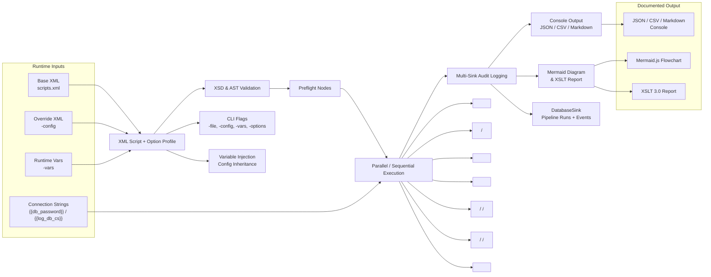

**Flow** is a Go-based, enterprise-grade ETL orchestration engine and pipeline executor driven by XML pipeline definitions and an optional HTMX visual web UI. It bridges declarative pipeline design with execution, supporting multi-dialect relational and key-value database operations, parallel processing, embedded scripting (via the Yaegi Go interpreter), multi-sink event telemetry, and automated diagram generation.

---

### Core System Architecture & CLI Interface

The application functions as a zero-dependency binary CLI runner and interactive server. Pipeline behavior, inputs, and environments are managed through CLI flags, XML configurations, and variable injection mechanisms.

| Flag / Parameter | Type | Default | Automation & ETL Purpose |
| --- | --- | --- | --- |
| `-builder` | `bool` | `false` | Launches the interactive HTMX web server backed by `flow_builder.db` for visual pipeline design. |
| `-builder-port` | `int` | `0` | Specifies the listening port for the visual builder web server (default `0` for dynamic ephemeral port). |
| `-file` | `string` | `scripts.xml` | Specifies the primary XML configuration file containing pipeline nodes, variables, and DB definitions. |
| `-config` | `string` | `""` | Secondary XML configuration file path for environment-specific overrides (DBs, variables, preflight nodes). |
| `-vars` | `string` | `""` | Comma-separated `key=value` runtime variable overrides (e.g., `-vars "TargetTable=foo,Limit=100"`). |
| `-options` | `string` | `""` | XML file containing pre-configured default CLI flag options (applies options only if not explicitly set on CLI). |
| `-validate` | `bool` | `false` | Runs non-executing validation passes (XSD schema validation and semantic AST check). |
| `-preflight` | `bool` | `false` | Executes preflight validation nodes only (e.g., source file checks, staging table verification) without running main flow. |
| `-format` | `string` | `csv` | Execution result output renderer (`json`, `jsonpretty`, `text`, `markdown`, `csv`, `stream`). |
| `-xslt` / `-out` | `string` | `""` | Path to XSLT stylesheet and output file to transform pipeline XML and inject generated Mermaid diagrams. |

---

### Orchestration & Control Flow Primitives

Flow builds an Abstract Syntax Tree (AST) from XML definitions, supporting complex execution topologies, branching logic, and streaming data movement.

| AST Element | Execution Semantics & Capabilities |
| --- | --- |
| `<script>` | Executes script logic in specified languages (e.g., Go via Yaegi, SQL) with optional target database row-streaming (`target_db`). |
| `<sql>` / `<sql_bulk>` | Executes single or bulk SQL operations against registered relational or K/V database connections. |
| `<group>` | Groups related execution steps into a logical sequential unit. |
| `<parallel>` | Executes child pipeline nodes concurrently across threads and joins them at completion. |
| `<if>` | Evaluates dynamic conditions (`condition` string or `var == equals`) to branch into `<then>` or `<else>` blocks. |
| `<foreach>` / `<loop>` / `<while>` | Iterates over dataset records or variable criteria, executing child nodes per row until completion. |
| `<preflight>` | Dedicated execution phase intended for schema sanity checks, target table truncations, and prerequisite validation. |

---

### Multi-Dialect Database Support & Telemetry Sinks

Flow provides abstract database handling across both traditional relational engines and Key-Value stores. Connection strings support dynamic variable template resolution (e.g., `{{log_db_cs}}`).

| Storage Engine / Dialect | Parameter Placeholder | Special SQL Dialect Handling |
| --- | --- | --- |
| **PostgreSQL** | `$1, $2, $3` | Auto-detected from `postgres://` or `dbname=` connection strings. |
| **Microsoft SQL Server** | `@p1, @p2, @p3` | Auto-detects driver; prepends `dbo.` to table names if schema is omitted. |
| **Oracle** | `:1, :2, :3` | Auto-detected via `oracle://` or driver reflection (`godror`, `oracle`). |
| **MySQL / SQLite / K/V** | `?, ?, ?` | Standard positional binding; handles K/V lookup state and SQL dialects. |

#### Operational Logging & Audit Schemas

When a `log_db` database connection is configured, Flow automatically logs telemetry via `DatabaseSink` into two standardized tables:

1. **`pipeline_runs` (Pipeline-Level Summary Log):**
* Fields: `run_id`, `file_path`, `config_path`, `status`, `started_at`, `finished_at`, `duration_ms`, `task_count`, `error_class`, `error_message`.

2. **`pipeline_events` (Step-Level Event Audit):**
* Fields: `run_id`, `execution_id`, `sequence_num`, `occurred_at`, `event_type`, `node_kind`, `node_id`, `status`, `error_message`, `rows_read`, `rows_written`, `rows_affected`.

---

### Automation Lifecycle, Validation, and Documentation

* **Configuration Inheritance:** Variables and database configurations are merged hierarchically: Base XML (`scripts.xml`) < Override XML (`-config`) < CLI parameters (`-vars`). Connection string templates (e.g., `{{db_password}}`) are iteratively expanded up to 3 depth levels.

* **Pre-Execution Safety:** `-validate` verifies both XSD structural compliance (using `xmllint`) and semantic AST validity (checking node linkages and database references) without touching data stores.

* **Live Observability:** Using `-format stream`, execution progress is piped in real-time to stdout as RFC3339-timestamped CSV event streams alongside standard `DatabaseSink` persistence.

* **Visual Documentation Generation:** Flow parses pipeline XML directly into Mermaid.js TD flowcharts, capturing variable tables, database connections, conditional branches, loops, and parallel join nodes. The XSLT 3.0 transformation engine (`helium`/`xslt3`) can merge this flowchart directly into transformed reports or automated documentation packages.