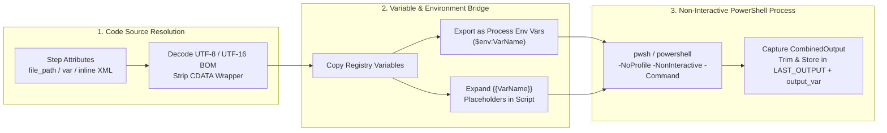

# PowerShell Scripting (`<script language="pwsh">` & `<script language="powershell">`)

## 1. Overview

Flow provides native support for both **PowerShell 7+ / PowerShell Core (`language="pwsh"`)** and **Windows PowerShell 5.1 (`language="powershell"`)**. PowerShell steps allow pipelines to leverage rich object pipelines, .NET types, `Invoke-RestMethod`, `Import-Csv`, Active Directory / Windows management cmdlets, and cross-platform system administration scripts directly inside a declarative Flow XML workflow.

| `language` Attribute | Binary Invoked by Flow | Supported Platforms | When to Use |
| :--- | :--- | :--- | :--- |
| **`language="pwsh"`** | `pwsh -NoProfile -NonInteractive -Command <script>` | **Windows, Linux, macOS, FreeBSD** | **Recommended for cross-platform pipelines.** Uses modern PowerShell 7+ (.NET-based) with consistent behavior across all operating systems. |
| **`language="powershell"`** | `powershell -NoProfile -NonInteractive -Command <script>` | **Windows only** | Ideal for Windows-only servers where Windows PowerShell 5.1 (`powershell.exe`) is pre-installed by the OS and zero external installations are desired, or when using legacy Windows-only modules (e.g., WMI/COM/AD). |

---

## 2. Execution Architecture & Lifecycle



1. **Source Resolution**: Flow resolves the PowerShell script source in the following order:
   - If `file_path` (or `file` / `path`) is set, Flow expands any `{{VarName}}` placeholders in the path, reads the external `.ps1` file from disk, and automatically decodes UTF-8, UTF-16LE, or UTF-16BE encodings.
   - If `var` (or `variable`) is set, Flow retrieves the PowerShell script content from that pipeline variable.
   - Otherwise, Flow reads the inline `<script>` body and strips any outer `<![CDATA[ ... ]]>` wrapper.
2. **Dual Variable Bridge**:
   - Flow snapshots all current variables in the pipeline `Registry` and exports them as environment variables (`$env:VarName`) in the child PowerShell process.
   - Flow also replaces any `{{VarName}}` template placeholders in the script text with their string values.
3. **Non-Interactive Execution**: Flow spawns `pwsh` (or `powershell`) with `-NoProfile -NonInteractive -Command <codeToEval>` bound to the step's `context.Context` (`timeout` and pipeline cancellation).
4. **Output Capture**: Combined standard output and standard error (`Write-Output`, `Write-Host`, `[Console]::Write`) are captured, trimmed of trailing whitespace/newlines, and saved to `LAST_OUTPUT` and `output_var`.

---

## 3. Prerequisites & Installation (`pwsh` for Cross-Platform Pipelines)

- **Windows PowerShell (`language="powershell"`)**: Pre-installed on all Windows 10, Windows 11, and Windows Server hosts—no installation required.
- **PowerShell 7+ (`language="pwsh"`)**: Install via your platform package manager or as a `.NET Global Tool`:

```powershell
# Windows (via winget)
winget install --id Microsoft.PowerShell --source winget
```

```bash
# Ubuntu / Debian / RHEL / macOS / FreeBSD (Universal via .NET SDK Global Tool)
dotnet tool install --global PowerShell
export PATH="$PATH:$HOME/.dotnet/tools"

# macOS (via Homebrew)
brew install --cask powershell

# Verify non-interactive execution
pwsh -NoProfile -NonInteractive -Command '$PSVersionTable.PSVersion.ToString()'
```

> [!NOTE]
> For distribution-specific Linux repository setup (`apt` / `dnf` / `snap`), see [Section 10.2 of the Compilation & Build Guide](guides/COMPILATION_AND_BUILD_GUIDE.md#102-installing-powershell-pwsh-on-linux-macos-freebsd-for-script-languagepwsh).

---

## 4. XML Attribute Reference

| Attribute | Required | Default | Description |
| :--- | :---: | :---: | :--- |
| `language` / `type` | **Yes** | — | Set to `"pwsh"` (PowerShell 7+) or `"powershell"` (Windows PowerShell 5.1). |
| `id` | No | — | Unique step identifier for logging, auditing, and telemetry. |
| `file_path` | No | — | Path to an external `.ps1` file on disk. Supports `{{VarName}}` interpolation and UTF-8/UTF-16 BOM decoding. Aliases: `file`, `path`. |
| `var` | No | — | Name of a pipeline variable containing the PowerShell code to execute. Alias: `variable`. |
| `output_var` | No | — | Pipeline variable name to store the captured output. Aliases: `output`, `output_variable`, `out_var`. Always also populates `LAST_OUTPUT`. |
| `timeout` | No | No limit | Maximum execution duration (e.g., `"30s"`, `"5m"`). Terminates the PowerShell process on expiration. |
| `retry_count` | No | `0` | Number of automatic retries if the script exits with a non-zero exit code or throws a terminating error. |
| `retry_delay` | No | `1s` | Delay between retry attempts (e.g., `"2s"`, `"5s"`). |
| `ignore_error` | No | `false` | When `true`, logs script failures as warnings and continues pipeline execution. |

---

## 5. Best Practices for PowerShell in Flow Pipelines

1. **Always Set `$ErrorActionPreference = 'Stop'`**:
   By default, PowerShell treats many cmdlet errors (such as missing files or failed network calls) as *non-terminating*, allowing the script to exit with code `0`. Adding `$ErrorActionPreference = 'Stop'` at the top of your script ensures any error immediately halts the script with a non-zero exit code so Flow's error/retry policy can respond.
2. **Prefer `$env:VarName` Over Unquoted `{{VarName}}`**:
   Because Flow automatically exports every pipeline variable into the child process environment, reading `$env:VarName` avoids quote-escaping issues when variable values contain single quotes, double quotes, dollar signs (`$`), or newlines.
3. **Use `ConvertTo-Json -Compress` for Multi-Field Output**:
   When returning multiple values to the pipeline, pipe a hashtable or `[PSCustomObject]` to `ConvertTo-Json -Compress` and extract individual properties in downstream `<json_path>` steps.
4. **Use `Join-Path` for Cross-Platform File Paths**:
   In `language="pwsh"` scripts that run on both Windows and Linux, use `Join-Path $env:EXPORT_DIR "report.csv"` instead of hardcoded `\` backslashes.

---

## 6. Practical Examples

### Example 1: Cross-Platform CSV Inspection & Structured JSON Output (`language="pwsh"`)

Uses PowerShell 7 (`pwsh`) to inspect a data directory, calculate file metrics, emit compressed JSON to `output_var`, and extract fields with `<json_path>`.

```xml
<pipeline xmlns:xsi="http://www.w3.org/2001/XMLSchema-instance"
          xsi:noNamespaceSchemaLocation="https://raw.githubusercontent.com/etl-madness/flow/main/xsd/pipeline.xsd">
    <variables>
        <variable name="TargetDir" type="string" value="./docs" />
        <variable name="FileExtension" type="string" value="*.md" />
        <variable name="ScanMetricsJson" type="string" value="" />
        <variable name="MarkdownFileCount" type="int" value="0" />
    </variables>

    <flow>
        <script id="ScanDirectoryMetrics"
                language="pwsh"
                timeout="15s"
                output_var="ScanMetricsJson">
            <![CDATA[
            $ErrorActionPreference = 'Stop'

            $dir = $env:TargetDir
            $filter = $env:FileExtension

            if (-not (Test-Path -LiteralPath $dir)) {
                throw "Target directory does not exist: $dir"
            }

            $files = @(Get-ChildItem -LiteralPath $dir -Filter $filter -File -Recurse)
            $totalBytes = ($files | Measure-Object -Property Length -Sum).Sum
            if ($null -eq $totalBytes) { $totalBytes = 0 }

            $result = [PSCustomObject]@{
                file_count  = $files.Count
                total_bytes = [int64]$totalBytes
                scanned_at  = (Get-Date).ToUniversalTime().ToString("yyyy-MM-ddTHH:mm:ssZ")
            }

            $result | ConvertTo-Json -Compress
            ]]>
        </script>

        <json_path id="ExtractFileCount"
                   input_var="ScanMetricsJson"
                   query="$.file_count"
                   output_var="MarkdownFileCount" />

        <assert id="VerifyFilesFound"
                condition="{{MarkdownFileCount}} > 0"
                message="Expected at least 1 Markdown file in {{TargetDir}}" />
    </flow>
</pipeline>
```

---

### Example 2: Windows Service & Disk Readiness Preflight Check (`language="powershell"`)

Uses built-in Windows PowerShell 5.1 (`powershell.exe`) inside a `<preflight>` block to verify free disk space and check Windows service status before running a bulk ETL job.

```xml
<pipeline xmlns:xsi="http://www.w3.org/2001/XMLSchema-instance"
          xsi:noNamespaceSchemaLocation="https://raw.githubusercontent.com/etl-madness/flow/main/xsd/pipeline.xsd">
    <variables>
        <variable name="SystemDriveLetter" type="string" value="C" />
        <variable name="MinFreeGB" type="float" value="2.0" />
        <variable name="DiskCheckSummary" type="string" value="" />
    </variables>

    <preflight>
        <script id="CheckWindowsDiskFreeSpace"
                language="powershell"
                timeout="10s"
                output_var="DiskCheckSummary">
            <![CDATA[
            $ErrorActionPreference = 'Stop'

            $driveLetter = $env:SystemDriveLetter
            $minFreeGB   = [double]$env:MinFreeGB

            $drive = Get-PSDrive -Name $driveLetter -PSProvider FileSystem
            $freeGB = [math]::Round($drive.Free / 1GB, 2)

            if ($freeGB -lt $minFreeGB) {
                Write-Error "Insufficient disk space on ${driveLetter}: (${freeGB} GB free, minimum required: ${minFreeGB} GB)"
                exit 1
            }

            Write-Output "Drive ${driveLetter}: Ready (${freeGB} GB free)"
            ]]>
        </script>
    </preflight>

    <flow>
        <script id="LogPreflightResult" language="powershell">
            <![CDATA[
            Write-Output "Preflight passed: $env:DiskCheckSummary"
            ]]>
        </script>
    </flow>
</pipeline>
```

---

### Example 3: Transforming & Filtering JSON Payloads with PowerShell Objects (`language="pwsh"`)

Parses an input JSON payload from a pipeline variable using `ConvertFrom-Json`, applies calculated properties, and outputs a formatted summary.

```xml
<pipeline xmlns:xsi="http://www.w3.org/2001/XMLSchema-instance"
          xsi:noNamespaceSchemaLocation="https://raw.githubusercontent.com/etl-madness/flow/main/xsd/pipeline.xsd">
    <variables>
        <variable name="BatchPayloadJson" type="string" value='[{"sku":"A-100","qty":12,"price":25.0},{"sku":"B-200","qty":0,"price":99.0},{"sku":"C-300","qty":5,"price":40.0}]' />
        <variable name="ActiveInventoryValue" type="string" value="" />
    </variables>

    <flow>
        <script id="ComputeInventoryValuation"
                language="pwsh"
                output_var="ActiveInventoryValue">
            <![CDATA[
            $ErrorActionPreference = 'Stop'

            $items = $env:BatchPayloadJson | ConvertFrom-Json
            $activeItems = $items | Where-Object { $_.qty -gt 0 }

            $totalValue = 0.0
            foreach ($item in $activeItems) {
                $totalValue += ([double]$item.qty * [double]$item.price)
            }

            [Console]::Write($totalValue.ToString("0.00", [System.Globalization.CultureInfo]::InvariantCulture))
            ]]>
        </script>

        <assert id="VerifyValuation"
                var="ActiveInventoryValue"
                equals="500.00"
                message="Expected active inventory valuation of 500.00" />
    </flow>
</pipeline>
```

---

### Example 4: Executing External `.ps1` Script Files (`file_path`)

Store reusable PowerShell scripts on disk (UTF-8 or UTF-16 BOM) and execute them via `file_path`:

```xml
<pipeline xmlns:xsi="http://www.w3.org/2001/XMLSchema-instance"
          xsi:noNamespaceSchemaLocation="https://raw.githubusercontent.com/etl-madness/flow/main/xsd/pipeline.xsd">
    <variables>
        <variable name="SCRIPTS_DIR" type="string" value="./scripts/powershell" />
        <variable name="EnvironmentName" type="string" value="STAGING" />
        <variable name="RotationStatus" type="string" value="" />
    </variables>

    <flow>
        <script id="RotateStagingLogs"
                language="pwsh"
                file_path="{{SCRIPTS_DIR}}/rotate_logs.ps1"
                timeout="60s"
                output_var="RotationStatus" />
    </flow>
</pipeline>
```

Example `./scripts/powershell/rotate_logs.ps1`:
```powershell
$ErrorActionPreference = 'Stop'

$envName = $env:EnvironmentName
if ([string]::IsNullOrWhiteSpace($envName)) {
    throw "EnvironmentName pipeline variable is required."
}

Write-Output "Log rotation completed for environment: $envName"
```

---

## 7. Related Documentation

- **[Multi-Language Script Guide (`script.md`)](script.md)**: Complete reference for all `<script>` runtimes (`go`, `lua`, `csx`, `pwsh`, `powershell`, `bash`, `cmd`, `sql`).
- **[Bash & POSIX Shell Scripting Guide (`bash.md`)](bash.md)**: Reference for `<script language="bash" | "git-bash" | "sh">`.
- **[Embedded Go Scripting Guide (`golang.md`)](golang.md)**: Zero-dependency in-process Go interpreter (`Yaegi`).
- **[Embedded Lua Scripting Guide (`lua.md`)](lua.md)**: Zero-dependency in-process Lua 5.1 VM (`Gopher-Lua`).
- **[C# Scripting Guide (`csx.md`)](csx.md)**: Cross-platform Roslyn C# scripting (`dotnet-script`).
- **[Compilation & Build Guide — Installing `pwsh`](guides/COMPILATION_AND_BUILD_GUIDE.md#102-installing-powershell-pwsh-on-linux-macos-freebsd-for-script-languagepwsh)**: Installation instructions for PowerShell 7+ across Linux, macOS, and FreeBSD.
