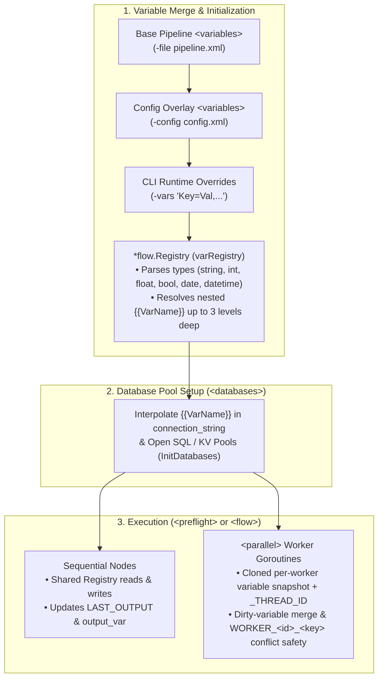

# `<variables>` — Pipeline Variables Container, Lifecycle & Scoping Guide

The `<variables>` element is the **first** top-level container in a Flow XML pipeline (`<pipeline>`). It declares the initial collection of typed pipeline variables ([`<variable>`](variable.md)) that are loaded into Flow's thread-safe state registry (`*flow.Registry`) before any database connections are opened or any `<preflight>` or `<flow>` nodes are executed.

---

## 1. Where `<variables>` Fits in the Overall `<pipeline>`

In the Flow XML Schema (`pipeline.xsd`), `<variables>` is **Stage 1** of the four top-level sections inside `<pipeline>` (`<variables>` → `<databases>` → `<preflight>` → `<flow>`):

```xml
<?xml version="1.0" encoding="UTF-8"?>
<pipeline name="RegionalSalesSync"
          description="Demonstrates where <variables> fits as Stage 1 of the pipeline lifecycle"
          xmlns:xsi="http://www.w3.org/2001/XMLSchema-instance"
          xsi:noNamespaceSchemaLocation="https://raw.githubusercontent.com/etl-madness/flow/main/xsd/pipeline.xsd">

    <!-- STAGE 1: <variables> — Parsed and initialized FIRST into the Registry -->
    <variables description="Global connection parameters, batch window, and runtime accumulators">
        <variable name="DB_HOST" type="string" value="localhost" />
        <variable name="DB_PORT" type="int" value="5432" />
        <variable name="RegionCode" type="string" value="NA-EAST" />
        <variable name="MinOrderAmount" type="float" value="100.00" />
        <variable name="ExportCount" type="int" value="0" />
    </variables>

    <!-- STAGE 2: <databases> — Immediately consumes {{VarName}} placeholders from <variables> -->
    <databases description="PostgreSQL source database">
        <database name="sales_pg"
                  driver="postgres"
                  connection_string="postgres://etl_user:{{PG_PASS}}@{{DB_HOST}}:{{DB_PORT}}/sales?sslmode=disable" />
    </databases>

    <!-- STAGE 3: <preflight> — Validates variable constraints and database reachability -->
    <preflight>
        <assert id="check_region" var="RegionCode" equals="" operator="!=" message="RegionCode must not be empty" />
        <sql id="ping_sales_db" db="sales_pg">SELECT 1;</sql>
    </preflight>

    <!-- STAGE 4: <flow> — Reads and mutates variables across SQL, scripts, templates, and assertions -->
    <flow>
        <sql id="count_regional_orders" db="sales_pg" output_var="ExportCount" format="text">
            SELECT COUNT(*)
            FROM orders
            WHERE region = '{{RegionCode}}' AND total_amount >= {{MinOrderAmount}};
        </sql>
    </flow>

</pipeline>
```

### Why `<variables>` Is Initialized First



Because `<variables>` is evaluated before `<databases>`, `<preflight>`, and `<flow>`:
1. **Dynamic Connection Strings**: Every `<database connection_string="...">` inside [`<databases>`](databases.md) can embed `{{VarName}}` placeholders declared in `<variables>` (or injected via `-config` / `-vars`).
2. **Fail-Fast Type Validation**: `registry.InitVariables` validates and converts every `<variable>` according to its declared `type` (`int`, `float`, `bool`, `date`, `datetime`, `string`) before any database connection or execution step is attempted.
3. **Single Source of Truth for Defaults**: Pipeline authors declare sensible default variables and accumulator placeholders (`output_var` targets) in `<variables>` at the top of the file, making the pipeline self-documenting.

---

## 2. `<variables>` Schema & Override Precedence

### `<variables>` Container Schema

| Attribute / Child | Mandatory | Description |
| :--- | :---: | :--- |
| `description` | No | Optional human-readable summary of the variable collection. |
| [`<variable>`](variable.md) | No (`0..*`) | Zero or more individual typed variable declarations (`name`, `type`, `value`, `id`, `description`). |

> [!NOTE]
> `<variables>` is optional (`minOccurs="0"`, `maxOccurs="1"`) and must appear before `<databases>`, `<preflight>`, and `<flow>` when present. For detailed attribute rules and data type parsing on individual `<variable>` items, see **[`<variable>` — Pipeline Variables & Registry Guide](variable.md)**.

### 4-Layer Variable Precedence Hierarchy

When Flow runs a pipeline, variables can be supplied or mutated at four levels (listed from lowest to highest precedence):

| Precedence | Source | When Applied | Behavior |
| :---: | :--- | :--- | :--- |
| **1 (Lowest)** | **Base `<variables>`** (`-file pipeline.xml`) | Startup (Step 1) | Sets baseline default values and types for all declared variables. |
| **2** | **Overlay `<variables>`** (`-config config.xml`) | Startup (Step 2) | Appends new variables and overwrites any base `<variable>` with the same `name`. |
| **3** | **CLI `-vars` Flag** (`-vars "K1=V1,K2=V2"`) | Startup (Step 3) | Highest startup precedence; overrides both `-file` and `-config` values and supports recursive `{{Var}}` expansion up to 3 levels deep. |
| **4 (Highest)** | **Runtime Node Mutations** (`<preflight>` / `<flow>`) | During Execution | Nodes dynamically create or update variables via `output_var`, `status_var`, `fail_var`, `vars.Set(...)` (Go/Lua), or `<foreach>` column bindings. |

---

## 3. Variable Hierarchy, Scoping & Built-In Runtime Variables

### Sequential vs. `<parallel>` Scoping

Variables are stored in a unified `*flow.Registry`, with scoping rules that adapt automatically to the execution block:

| Scope | Execution Context | Behavior |
| :--- | :--- | :--- |
| **Shared Global Scope** | `<preflight>`, `<flow>`, `<group>`, `<if>`, `<foreach>`, `<while>` | Read and write actions are immediate and shared. Any step in a sequence immediately sees variables set or modified by preceding steps. |
| **Thread-Isolated Worker Scope** | [`<parallel>`](parallel.md) blocks | Flow **snapshots (deep-clones)** the registry's variables for each worker goroutine (`CloneForWorker`) and injects a 0-based `_THREAD_ID` variable. Only variables mutated by a worker (`dirty` variables) are merged back into the parent registry when `<parallel>` completes. If multiple parallel workers mutate the same variable key to different values, Flow namespaces them into `WORKER_<id>_<key>` to prevent race conditions. |

### Automatic Built-In Runtime Variables

In addition to user-defined `<variables>`, Flow automatically maintains the following runtime variables during execution:

| Variable Name | Scope | Type | Description |
| :--- | :--- | :---: | :--- |
| `LAST_OUTPUT` | Global / Current Scope | `string` | Automatically updated with the string output (`ResultsString`) of the most recently completed node (`<sql>`, `<script>`, `<template>`, `<http_client>`, `<file_read>`, etc.). |
| `LOOP_INDEX` | Inside [`<foreach>`](foreach.md) | `int` | Zero-based iteration counter (`0`, `1`, `2`, ...) updated on each row of a `<foreach>` / `<loop>` query. |
| `WHILE_INDEX` | Inside [`<while>`](while.md) | `int` | Zero-based iteration counter (`0`, `1`, `2`, ...) updated on each pass of a `<while>` loop. |
| `_THREAD_ID` | Inside [`<parallel>`](parallel.md) | `int` | Zero-based worker index assigned to each concurrent branch inside `<parallel>`. |

---

## 4. Reading and Writing Variables Across Runtimes

### 4.1 Mustache Interpolation (`{{VarName}}`)
Across SQL queries, connection strings, file paths, HTTP URLs/headers, assertions, and scripts, Flow replaces `{{VarName}}` placeholders with the current value from the `Registry`.

Flow uses a single-pass $O(N)$ placeholder scanner (`Registry.InterpolateVars` / `interpolateVars`) with a fast-path check when no `{{` token is present, so strings without variables incur zero allocations and strings with variables are interpolated in a single left-to-right scan regardless of how many variables exist in the registry. Unknown tokens (such as Go template placeholders `{{.Field}}`) and outer braces (such as `{{{VarName}}}`) are preserved verbatim.

```xml
<sql id="QueryWithLimit" db="app_db">
    SELECT * FROM orders WHERE status = 'PENDING' LIMIT {{MaxLimit}};
</sql>
```

#### Programmatic Batch Mutation (`SetVars`, `SetRowVars` & `InterpolateVars`)
When embedding Flow in Go applications or iterating over high-throughput datasets, `*flow.Registry` provides batch mutation and interpolation helpers that acquire the registry lock only once per call:

* `r.SetVars(vars map[string]interface{})`: Sets multiple variables atomically under a single mutex write lock (`Lock`) and marks all provided keys as dirty for `<parallel>` branch merging.
* `r.SetRowVars(cols, lowerCols, upperCols []string, vals []interface{}, loopIndex int)`: Binds an entire SQL row (`LOOP_INDEX` plus exact, lowercase, and uppercase column names) under a single mutex write lock without allocating an intermediate map.
* `r.InterpolateVars(input string) string`: Performs single-pass `{{VarName}}` replacement under a read lock (`RLock`) without cloning the variable map.

### 4.2 Embedded Go Scripts (`language="go"` — `"host/vars"`)
Inside [Embedded Go (`Yaegi`) scripts](golang.md), import `"host/vars"` to read and write typed variables directly in memory without serialization overhead:

* **Typed Getters**: `vars.Get(name)`, `vars.GetString(name)`, `vars.GetInt(name)`, `vars.GetBool(name)`, `vars.GetFloat(name)`, `vars.GetTime(name)`, `vars.GetAll()`
* **Typed Setters**: `vars.Set(name, val)`, `vars.SetString(name, val)`, `vars.SetInt(name, val)`, `vars.SetBool(name, val)`, `vars.SetFloat(name, val)`, `vars.SetTime(name, val)`

```xml
<script id="GoVarBridge" language="go" output_var="StepSummary">
    <![CDATA[
    package main

    import (
        "fmt"
        "host/vars"
    )

    func main() {
        threshold := vars.GetInt("Threshold")
        table     := vars.GetString("TargetTable")

        // Mutate variables directly in the Registry
        vars.SetInt("NextThreshold", threshold*2)
        vars.SetBool("ValidationPassed", true)

        // Anything printed to stdout is also captured into LAST_OUTPUT and output_var ("StepSummary")
        fmt.Printf("Processed %s with threshold %d", table, threshold)
    }
    ]]>
</script>
```

### 4.3 Embedded Lua Scripts (`language="lua"` — Global `vars` Table)
Inside [Embedded Lua scripts](lua.md), the global `vars` table provides direct bidirectional access to the `Registry`:

```xml
<script id="LuaVarBridge" language="lua">
    <![CDATA[
    local threshold = vars.GetInt("Threshold")
    vars.Set("AdjustedThreshold", threshold + 10)
    vars.Set("AuditMetadata", { status = "OK", multiplier = 1.25 })
    ]]>
</script>
```

### 4.4 C# (`csx`), PowerShell (`pwsh` / `powershell`), and Bash (`bash` / `sh`)
For external process runtimes, Flow automatically injects all current `Registry` variables into the child process environment (`cmd.Env`) and captures `stdout` into `output_var`:

* **[C# (`csx`)](csx.md)**: Read via `Environment.GetEnvironmentVariable("TargetTable")` and write to `output_var` via `Console.Write(...)`.
* **[PowerShell (`pwsh` / `powershell`)](powershell.md)**: Read via `$env:TargetTable` and write to `output_var` via `Write-Output` / `ConvertTo-Json -Compress`.
* **[Bash & POSIX Shells (`bash` / `git-bash` / `sh`)](bash.md)**: Read via `"${TargetTable}"` and write to `output_var` via `printf` / `echo`.

### 4.5 SQL Queries & Structured Extractors (`output_var`)
* **[`<sql output_var="...">`](sql.md)**: Captures a scalar value (for single-row, single-column queries) or formatted result set (`text`, `csv`, `json`, `markdown`) into the named variable.
* **[`<json_path>`](json_path.md), [`<xml_xpath>`](xml_path.md), [`<yaml_path>`](yaml_path.md)**: Extract nested properties from JSON, XML, or YAML payloads directly into pipeline variables.

---

## 5. Loops (`<foreach>`) and Automatic Column Binding

When iterating over records using a [`<foreach>`](foreach.md) block, the loop driver query binds the following variables automatically for each iteration:

* `LOOP_INDEX`: The current 0-indexed loop iteration counter (`int`).
* **Row Columns**: Each column from the current SQL row is bound into the `Registry` under three casings to prevent case-sensitivity bugs across database dialects:
  1. **Original Column Case** (e.g., `UserId`)
  2. **Lowercase** (e.g., `userid`)
  3. **Uppercase** (e.g., `USERID`)

```xml
<foreach id="IterateUsers" db="app_db">
    SELECT id, username, email FROM users WHERE active = 1;

    <!-- Each iteration binds "id", "username", "email", and "LOOP_INDEX" -->
    <sql id="ProcessUser" db="app_db">
        INSERT INTO user_audit (user_id, action)
        VALUES ({{id}}, 'Processed {{username}} at iteration {{LOOP_INDEX}}');
    </sql>
</foreach>
```

---

## 6. Advanced Inter-Step Variable Patterns

### Example A: Passing Structured JSON Between Steps
For multi-field objects, declare a JSON holder variable in `<variables>`, emit JSON into `output_var`, and consume it in downstream steps via Go structs or [`<json_path>`](json_path.md):

```xml
<pipeline xmlns:xsi="http://www.w3.org/2001/XMLSchema-instance"
          xsi:noNamespaceSchemaLocation="https://raw.githubusercontent.com/etl-madness/flow/main/xsd/pipeline.xsd">
    <variables>
        <variable name="ServiceJSON" type="string" value="{}" />
    </variables>

    <flow>
        <!-- Step 1: Produce JSON payload into ServiceJSON -->
        <script id="FetchServiceConfig" language="go" output_var="ServiceJSON">
            <![CDATA[
            package main
            import (
                "encoding/json"
                "fmt"
            )
            type ConnectionDetails struct {
                Host string `json:"host"`
                Port int    `json:"port"`
                SSL  bool   `json:"ssl"`
            }
            func main() {
                cfg := ConnectionDetails{
                    Host: "db-replica.internal",
                    Port: 5432,
                    SSL:  true,
                }
                bytes, _ := json.Marshal(cfg)
                fmt.Print(string(bytes))
            }
            ]]>
        </script>

        <!-- Step 2: Unmarshal and utilize the JSON payload in a subsequent step -->
        <script id="ConnectToService" language="go">
            <![CDATA[
            package main
            import (
                "encoding/json"
                "fmt"
                "host/vars"
            )
            type ConnectionDetails struct {
                Host string `json:"host"`
                Port int    `json:"port"`
                SSL  bool   `json:"ssl"`
            }
            func main() {
                jsonStr := vars.GetString("ServiceJSON")
                var cfg ConnectionDetails
                if err := json.Unmarshal([]byte(jsonStr), &cfg); err != nil {
                    panic(err)
                }
                fmt.Printf("Connected to %s:%d (SSL: %t)\n", cfg.Host, cfg.Port, cfg.SSL)
            }
            ]]>
        </script>
    </flow>
</pipeline>
```

### Example B: Passing Variables Across Polyglot Runtimes (C# → Go → SQL)
Variables stored in `<variables>` flow seamlessly between external process scripts (`csx`, `pwsh`, `bash`), embedded VMs (`go`, `lua`), and database nodes:

```xml
<pipeline xmlns:xsi="http://www.w3.org/2001/XMLSchema-instance"
          xsi:noNamespaceSchemaLocation="https://raw.githubusercontent.com/etl-madness/flow/main/xsd/pipeline.xsd">
    <variables>
        <variable name="Threshold" type="int" value="42" />
        <variable name="CS_Result" type="string" value="" />
    </variables>

    <flow>
        <!-- Step 1: Read Threshold variable in C#, run calculations, and store output -->
        <script id="CsharpStep" language="csx" output_var="CS_Result">
            <![CDATA[
            using System;
            string rawThreshold = Environment.GetEnvironmentVariable("Threshold");
            if (int.TryParse(rawThreshold, out int threshold)) {
                Console.Write($"Threshold was {threshold}, calculated result is {threshold * 2}");
            }
            ]]>
        </script>

        <!-- Step 2: Read the C# result inside an embedded Go script -->
        <script id="GoStep" language="go">
            <![CDATA[
            package main
            import (
                "fmt"
                "host/vars"
            )
            func main() {
                csVal := vars.GetString("CS_Result")
                fmt.Printf("Go received from C#: %s\n", csVal)
            }
            ]]>
        </script>
    </flow>
</pipeline>
```

---

## 7. Related Documentation

- **[`<variable>` — Individual Variable Element & Type Parsing Reference](variable.md)**: Detailed reference for `<variable>` attributes (`name`, `type`, `value`, `id`, `description`) and type conversion rules.
- **[`<databases>` — Databases Container & Lifecycle Guide](databases.md)**: How `<variables>` placeholders are interpolated into `<databases>` connection strings.
- **[`<preflight>` Validation Gates](preflight.md)** & **[`<flow>` Main Execution Container](flow.md)**: How variables are validated in `<preflight>` and mutated in `<flow>`.
- **[Configuration & Execution Hierarchy](guides/CONFIG_HIERARCHY.md)**: Deep dive into merging `-file`, `-options`, `-config`, and `-vars`.
